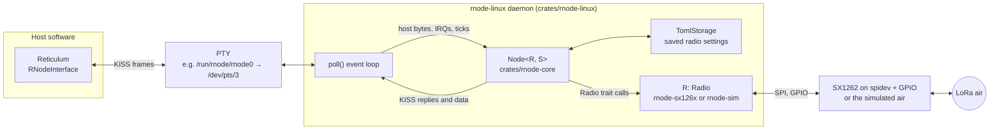
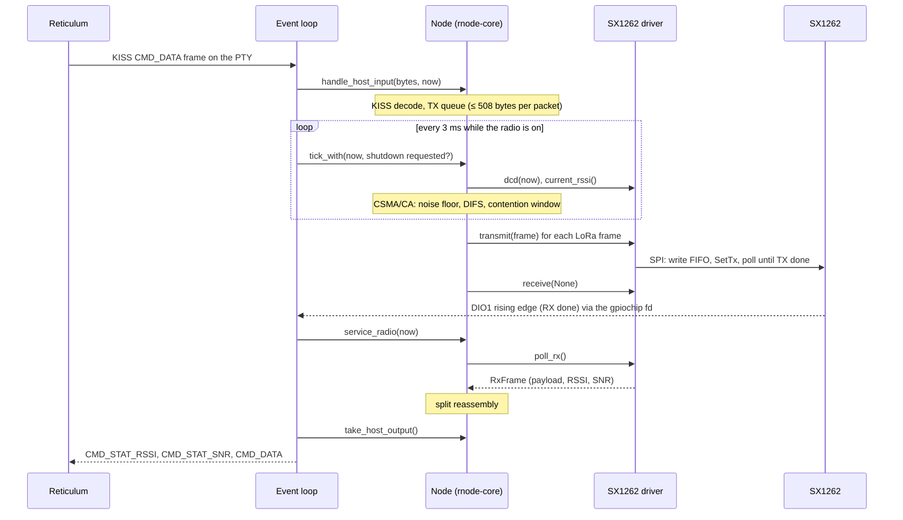
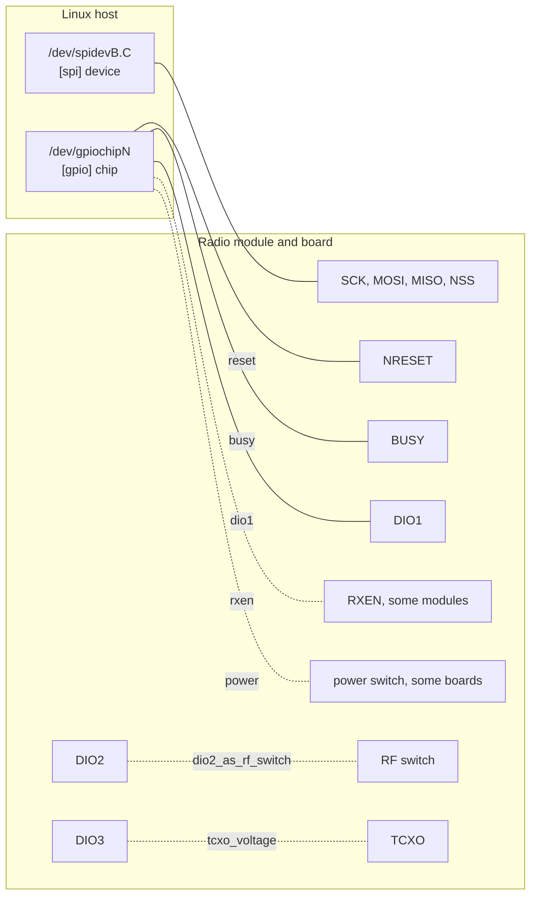

# rnode-linux

rnode-linux turns a Linux computer with a LoRa modem on its SPI bus into an
[RNode](https://unsigned.io/rnode/). The daemon drives the modem directly and exposes a
pseudo-terminal (PTY) that speaks the RNode KISS host protocol. Reticulum's `RNodeInterface`, or
any other RNode host, uses that PTY exactly like the serial port of a USB-attached RNode running
RNode_Firmware. On the air, rnode-linux interoperates with real RNodes.

The supported modem is the Semtech SX1262, optionally with a power amplifier after it (not yet
tested on such hardware). The reference platform is the Clockwork uConsole (CM5) with the
HackerGadgets AIO V2 extension board. A simulated radio lets you run everything, including
Reticulum end-to-end tests, on any Linux or macOS machine without radio hardware.

Behaviour follows [RNode_Firmware](https://github.com/markqvist/RNode_Firmware) v1.86 (commit
`56775c5`) wherever a host or another radio can observe it. The deliberate differences are listed in
[Differences from RNode_Firmware](#differences-from-rnode_firmware).

## Contents

- [Why rnode-linux](#why-rnode-linux)
- [How it works](#how-it-works)
- [Workspace layout](#workspace-layout)
- [Safety and radio regulations](#safety-and-radio-regulations)
- [Quick start without hardware](#quick-start-without-hardware)
- [Building](#building)
- [Setting up the LoRa hardware](#setting-up-the-lora-hardware)
- [Configuration reference](#configuration-reference)
- [Running with Reticulum](#running-with-reticulum)
- [Running as a systemd service](#running-as-a-systemd-service)
- [Logging](#logging)
- [Recording SPI traffic](#recording-spi-traffic)
- [Simulation and tests](#simulation-and-tests)
- [Code coverage](#code-coverage)
- [Hardware test tools](#hardware-test-tools)
- [Differences from RNode_Firmware](#differences-from-rnode_firmware)
- [Limitations](#limitations)
- [Troubleshooting](#troubleshooting)
- [Contributing](#contributing)
- [License](#license)

## Why rnode-linux

An RNode is usually a microcontroller board with a LoRa modem, connected to the computer running
Reticulum over USB serial or Bluetooth. Many single-board computers and handhelds already have a
LoRa modem wired straight to their SPI bus, with no microcontroller in between. rnode-linux lets
that modem act as an RNode:

- **No extra hardware.** The Linux host drives the modem itself; there is no microcontroller, no
  firmware to flash and no USB serial link.
- **Unchanged host software.** Reticulum's `RNodeInterface` opens the PTY as if it were a serial
  RNode. Reticulum needs no patches or plugins.
- **Interoperability.** On-air framing, modulation parameters, sync word, preamble length,
  low-data-rate optimisation and CSMA/CA follow the firmware, so real RNodes hear rnode-linux and
  rnode-linux hears them.
- **Linux tooling.** Configuration lives in a TOML file, the daemon runs under systemd, logs go to
  the journal with optional per-packet detail, and an SPI recorder captures every modem transaction.
- **Testability.** The RNode logic is a pure Rust library tested against values derived from the
  firmware. A simulated radio runs the whole daemon in CI, under real Reticulum too.

rnode-linux is not a Reticulum interface and not a new protocol: it is the modem side of the
existing RNode protocol, running on Linux instead of a microcontroller.

## How it works



The work is split into layers:

- **`rnode-core`** decides *what* an RNode does: the KISS host protocol, the TX queue, the RNode
  on-air framing (one header byte, packets over 254 bytes split into two LoRa frames), PHY timing,
  CSMA/CA and airtime accounting. It does no I/O: the platform passes the time in and calls it when
  the host sends bytes, when the radio signals, and periodically.
- **A radio driver** implements the `rnode_core::Radio` trait for one modem: SPI opcodes,
  registers, GPIO timing and chip quirks. See [DRIVERS.md](DRIVERS.md).
- **The daemon** reads the config, opens spidev, the GPIO character device and the PTY, then runs
  the event loop: it waits on the PTY, the modem's IRQ line and the node's next wake-up time, and
  feeds whatever happened into the node.

A packet's round trip through the stack:



The event loop also calls `service_radio()` on every iteration, so a missed IRQ costs at most one
loop iteration of latency. While the radio is on, the loop wakes every 3 ms (firmware
`STATUS_INTERVAL_MS`) to sample carrier detect and RSSI for CSMA/CA, as the firmware does. While it
is off, the loop waits for at most 50 ms between checks.

## Workspace layout

| Path | Contents |
| --- | --- |
| [`crates/rnode-core`](crates/rnode-core) | Hardware-independent RNode logic: KISS host protocol, TX queue, split framing, PHY timing, CSMA/CA, the `Node<R, S>` state machine, and the `Radio` and `Storage` traits. No I/O; time and randomness are passed in, so tests are deterministic. |
| [`crates/rnode-sx126x`](crates/rnode-sx126x) | SX1262 driver over `embedded-hal` 1.0 that mirrors RNode_Firmware `sx126x.cpp`. |
| [`crates/rnode-sim`](crates/rnode-sim) | Simulated LoRa radio. Daemons on one host share an "air" directory of Unix datagram sockets. |
| [`crates/rnode-linux`](crates/rnode-linux) | The daemon: config, GPIO character device, spidev, PTY, saved settings and event loop. |
| [`crates/xtask`](crates/xtask) | Repository automation: `cargo xtask rns-e2e` runs two simulated daemons under two Reticulum instances. |
| [`tests/e2e/kiss_probe.py`](tests/e2e/kiss_probe.py) | Standalone KISS probe for a daemon PTY. |
| [`tools/hwtest`](tools/hwtest) | Hardware bring-up for the uConsole AIO V2, RTL-SDR capture, LoRa burst analysis and an over-the-air LXMF echo test against a real RNode. Outside the Cargo workspace. |
| [`config.example.toml`](config.example.toml), [`config.uconsole-aio-v2.toml`](config.uconsole-aio-v2.toml) | Example daemon configurations. |
| [`contrib/rnode-linux.service`](contrib/rnode-linux.service) | Hardened systemd unit. |
| [`DRIVERS.md`](DRIVERS.md) | How radio drivers work and how to add one. |
| [`AGENTS.md`](AGENTS.md) | Rules for changing this repository. |

## Safety and radio regulations

- **Transmissions are regulated.** Frequency, bandwidth, TX power, duty cycle and antenna gain must
  be legal where you operate. The examples in this repository use 914.875 MHz, 125 kHz and 2 dBm,
  which suits the 902–928 MHz ISM band of the US and some other countries in ITU region 2. They are
  illegal in other regions: Europe, for example, uses 863–870 MHz with duty-cycle limits.
- **rnode-linux enforces no regional rules.** The host (Reticulum) chooses the frequency,
  bandwidth, spreading factor, coding rate and TX power over KISS, or they come from the saved
  settings file. The daemon only caps TX power at the SX1262's 22 dBm, or with a power amplifier
  at its [`max_output_dbm`](#radiopa), or at a lower ceiling you set with
  [`[radio] max_tx_power_dbm`](#radio). Reticulum's
  `airtime_limit_short` and `airtime_limit_long` options can help you stay within a duty cycle.
- **A power amplifier needs `[radio.pa]`.** With an amplifier after the SX1262, the host's TX
  power is the power after the amplifier, and [`[radio.pa]`](#radiopa) tells the daemon how much
  the amplifier adds. Without it, or with a wrong gain table, the daemon drives the amplifier as if
  it were the antenna, and the board puts out up to the amplifier's gain more than the host asked
  for. Support for amplifiers is untested on hardware: measure the output into a dummy load
  before you transmit through one.
- **Attach an antenna or a dummy load before transmitting.** Transmitting into an open RF port can
  damage the power amplifier.
- **Start with low power** (the examples use 2 dBm) and raise it only as far as you need and are
  allowed. `max_tx_power_dbm` keeps any host from going higher.

## Quick start without hardware

The `sim` driver replaces the modem with a simulated one, so you can try the daemon on any Linux
or macOS machine. Build it:

```sh
cargo build --release --locked -p rnode-linux
```

Save this as `sim-a.toml`:

```toml
[radio]
driver = "sim"

[radio.sim]
air_dir = "target/rnode-air"
node_name = "a"

[pty]
symlink = "target/rnode-a"

[storage]
radio_settings = "target/rnode-a-settings.toml"

[logging]
log_level = "debug"
```

Copy it to `sim-b.toml` and change `a` to `b` in `node_name`, `symlink` and `radio_settings`. Start
both daemons from the repository root; relative paths resolve against the daemon's working
directory:

```sh
target/release/rnode-linux --config sim-a.toml &
target/release/rnode-linux --config sim-b.toml &
```

Each daemon logs its PTY and creates the symlink:

```text
[2026-10-13T19:23:46Z INFO  rnode_linux] loaded config from sim-a.toml
[2026-10-13T19:23:46Z INFO  rnode_linux] PTY slave: /dev/pts/1
```

Now point two Reticulum instances at `target/rnode-a` and `target/rnode-b`, as described in
[Running with Reticulum](#running-with-reticulum), with the same radio parameters on both. Give each
instance its own config directory (`rnsd --config ./rns-a`) with `share_instance = No`, so that the
second one does not attach to the first. The daemons log when Reticulum turns the radio on, and
every packet at `debug`; here daemon A sends and daemon B receives:

```text
[2026-10-13T19:23:48Z INFO  rnode_core::node] radio online (host request): 914.875 MHz, 125 kHz, SF7, CR 4/5, 2 dBm
[2026-10-13T19:23:53Z DEBUG rnode_core::node] TX packet: 255 bytes, 2 frames, header 0xB1 (seq 11, split): ok
[2026-10-13T19:23:53Z DEBUG rnode_core::node] RX packet: 255 bytes, 2 frames, header 0xB1 (seq 11, split), RSSI -70 dBm, SNR 7.00 dB
```

Instead of Reticulum, [`tests/e2e/kiss_probe.py`](tests/e2e/kiss_probe.py) can configure a daemon
and send test packets; see [Simulation and tests](#simulation-and-tests). Stop the daemons with
`kill %1 %2`: each puts its radio to sleep and removes its symlink and socket.

## Building

You need Rust 1.85 or newer (the workspace uses edition 2024).

```sh
cargo build --release --locked -p rnode-linux
sudo install -m 0755 target/release/rnode-linux /usr/local/bin/rnode-linux
```

The `sx1262` driver needs Linux: it uses spidev and the GPIO character device
(`/dev/gpiochipN`). On other systems the daemon builds and runs, but only with the `sim` driver. The
reference uConsole builds the daemon natively.

```text
$ rnode-linux --help
RNode Linux daemon

Usage: rnode-linux [OPTIONS]

Options:
  -c, --config <CONFIG>  Path to the TOML configuration file [default: config.toml]
      --spilog <SPILOG>  Record SPI transactions to a CSV file (radio.driver = "sx1262" only)
  -h, --help             Print help
  -V, --version          Print version

$ rnode-linux --version
rnode-linux 0.2.0 (reports RNode firmware 1.86 to hosts)
```

- `--config` defaults to `config.toml` in the working directory.
- `--spilog` records every SPI transaction of the `sx1262` driver; see
  [Recording SPI traffic](#recording-spi-traffic). With `radio.driver = "sim"` the daemon refuses
  to start, because the simulator has no SPI bus.
- `--version` prints the daemon's version and the RNode firmware version it reports to hosts.

On a fatal error, such as an invalid config or a device that cannot be opened, the daemon prints
one `fatal:` line to stderr, naming each cause once, and exits with status 1:

```text
fatal: load nope.toml: failed to read nope.toml: No such file or directory (os error 2)
```

### Stopping the daemon

SIGINT and SIGTERM stop the daemon cleanly, with exit status 0. A shutdown request ends a burst of
transmissions between packets: the packet on the air is finished first, including the second
frame of a split packet, so a packet is never cut in half. The daemon then drops the packets still
queued (one `INFO` line with the count, and one `DEBUG` line per packet), puts the radio to sleep
and removes the PTY symlink. Here SIGTERM arrived while the first of four queued 200-byte packets
was on the air at SF11, and the daemon exited 1.1 s later:

```text
[2026-10-13T19:21:34Z DEBUG rnode_core::node] TX packet: 200 bytes, 1 frame, header 0x90 (seq 9): ok
[2026-10-13T19:21:34Z INFO  rnode_core::node] shutting down with 3 TX packets queued; dropping them
[2026-10-13T19:21:34Z DEBUG rnode_core::node] dropping 200-byte TX packet: shutting down
[2026-10-13T19:21:34Z DEBUG rnode_core::node] dropping 200-byte TX packet: shutting down
[2026-10-13T19:21:34Z DEBUG rnode_core::node] dropping 200-byte TX packet: shutting down
[2026-10-13T19:21:34Z INFO  rnode_core::node] radio offline (shutdown): 914.875 MHz, 125 kHz, SF11, CR 4/5, 2 dBm
```

RNode_Firmware sends every queued packet once a burst starts; stopping between packets is one of
the [deliberate differences](#differences-from-rnode_firmware).

With `power_off_on_exit = true`, the daemon switches the modem off last: it drives NRESET low, then
RXEN if the board has it, and only then the power line, so that no line is left driving the
unpowered modem. [`[gpio]`](#gpio) lists the state each line is left in, with and without the
setting.

#### How long a stop takes

A stop waits for at most one packet on the air, up to two 255-byte LoRa frames, and then takes a
few milliseconds. The worst case is a 508-byte packet, whose time on air depends on the modulation
the host chose (Semtech's formula, with the firmware's preamble and low-data-rate rules):

| Modulation | 508-byte packet, CR 4/5 | 508-byte packet, CR 4/8 |
| --- | --- | --- |
| SF7, 125 kHz | 0.8 s | 1.3 s |
| SF9, 125 kHz | 2.6 s | 4.0 s |
| SF11, 125 kHz | 8.7 s | 13 s |
| SF12, 125 kHz | 19 s | 29 s |
| SF12, 31.25 kHz | 75 s | 115 s |
| SF12, 15.6 kHz | 150 s | 230 s |
| SF12, 7.8 kHz | 300 s | 460 s (7 min 40 s) |

A packet of up to 254 bytes is one frame and takes half as long. The
[systemd unit](#installing-the-unit) allows 8 minutes, enough for every row. Other supervisors
must allow as long for the slowest settings your hosts use, or they kill the daemon in the middle
of a packet:

- Docker waits 10 s by default: stop the container with `docker stop -t 480 <container>`, or
  start it with `docker run --stop-timeout 480` to make that its default.
- Docker Compose: set `stop_grace_period: 8m` on the service.
- Other supervisors have an equivalent, for example `stopwaitsecs` in supervisord or
  `terminationGracePeriodSeconds` in Kubernetes.

#### When the daemon is killed

If a supervisor sends SIGKILL during a transmission, after a stop timeout that was too short:

- The frame on the air is still sent to the end. The driver starts each frame with the SX1262's
  `SetTx` in single mode (timeout 0), so the modem sends the frame from its buffer on its own and
  then falls back to standby (`STDBY_RC`; SX1261/2 datasheet, `SetTx` and
  `SetRxTxFallbackMode`). It does not keep transmitting.
- A split packet killed during its first frame loses its second frame: receivers get a lone first
  half, which a normal stop never leaves behind.
- The modem then idles in standby, neither receiving nor transmitting, until the daemon starts
  again and resets it.
- The daemon's cleanup does not run: the queued packets are dropped without log lines, the radio is
  not put to sleep, `power_off_on_exit` does not switch the modem off, and the PTY symlink stays
  behind, pointing to a PTY that no longer exists. The next start replaces it; under the systemd
  unit, systemd removes `/run/rnode`, symlink included, when the unit stops.
- The kernel releases the GPIO lines, as on any exit. Raspberry Pi kernels keep released outputs
  as they were (the `persist_gpio_outputs` option of their RP1 and BCM2835 GPIO drivers, on by
  default), so on the uConsole the modem keeps power and is not reset: the power line and NRESET
  stay high, even with `power_off_on_exit = true`. A GPIO driver that switches released lines back
  to inputs can instead cut the modem's power or hold it in reset, which ends the frame early.
- systemd logs `State 'stop-sigterm' timed out. Killing.` and marks the unit failed, with result
  `timeout`.

The daemon could end a frame early instead, by putting the modem in standby. It deliberately does
not. A frame cut short is lost to every receiver, and cutting a split packet's second frame leaves
the same lone first half, so aborting would only trade a slow stop for a lost packet; it would also
need a change to the `Radio` trait for every driver. RNode_Firmware has no abort either: an RNode
that loses power simply stops. The cost is a stop that can take minutes at the slowest settings,
which the stop timeout has to allow for.

## Setting up the LoRa hardware

### What the daemon needs from the board

The `sx1262` driver talks to the modem through one spidev device and up to five GPIO lines on one
GPIO chip. Two of the modem's own pins, DIO2 and DIO3, are configured inside the chip and need no
host GPIO.



| Modem signal | Host side | Config key | How the daemon uses it |
| --- | --- | --- | --- |
| SCK, MOSI, MISO, NSS | spidev device; the kernel drives chip select | `[spi] device`, `speed_hz` | SPI mode 0, 8-bit words |
| NRESET | GPIO output | `[gpio] reset` | Held high; pulsed low for 10 ms by `begin()`; driven low on exit before `power_off_on_exit` switches the modem off |
| BUSY | GPIO input | `[gpio] busy` | Polled before every command, up to `busy_timeout_ms` |
| DIO1 | GPIO input with rising-edge events | `[gpio] dio1` | RX-done interrupt; wakes the event loop |
| RXEN (optional) | GPIO output | `[gpio] rxen` | Driven high when the radio starts and on every receive, never low while the daemon runs (firmware `rxAntEnable()`); driven low on exit before `power_off_on_exit` switches the modem off |
| Power enable (optional) | GPIO output | `[gpio] power` | Driven high before the other lines are requested; held while the daemon runs; driven low last on exit with `power_off_on_exit` |
| DIO2 | inside the module | `[radio.sx1262] dio2_as_rf_switch` | SX1262 drives the RF switch from DIO2 |
| DIO3 | inside the module | `[radio.sx1262] tcxo_voltage` | SX1262 powers the TCXO from DIO3 at this voltage |

GPIO lines are offsets on a GPIO chip: what `gpioinfo` lists, not physical header pin numbers and
not the global numbers of the old sysfs GPIO interface.

### uConsole CM5 with the HackerGadgets AIO V2

The AIO V2 has an SX1262 with a 1.8 V TCXO powered from DIO3 and an RF switch driven by DIO2. It
has no RXEN line. The board switches its peripherals on and off with GPIOs on the CM5's RP1:

| GPIO | Function |
| --- | --- |
| 16 | LoRa (SX1262) power |
| 7 | RTL-SDR power |
| 23 | internal USB power |
| 27 | GPS power |

1. **Enable SPI1.** The SX1262 sits on SPI1, chip select 0, which appears as `/dev/spidev1.0`. On
   the reference unit `/boot/firmware/config.txt` enables it with:

   ```text
   dtoverlay=spi1-1cs
   ```

   Reboot and check that `/dev/spidev1.0` exists.

2. **Find the GPIO chip.** The modem's control lines are on the RP1 GPIO controller, whose chip
   label is `pinctrl-rp1`. On the reference image that is `/dev/gpiochip15`; `gpiodetect` from the
   gpiod tools shows the number on yours. The lines are RESET = 25, BUSY = 24 and DIO1 = 26. If the
   chip number changes between kernels, set `chip = "pinctrl-rp1"`: the daemon also accepts a chip
   label.

3. **Mind the power rail.** The AIO setup on the reference unit drives all four rails low at boot
   from `config.txt` (`gpio=7,16,23,27=op,dl` in the `[cm5]` section), so the SX1262 has no power
   until something drives GPIO16 high. `power = 16` makes the daemon do that: it drives the line
   high, waits `power_on_delay_ms`, then resets the modem. `pinctrl get 16` shows the current state
   (`dh` means driven high). With the rail off, `begin()` fails.

4. **Install the config.** [`config.uconsole-aio-v2.toml`](config.uconsole-aio-v2.toml) has the
   whole mapping:

   ```toml
   # Clockwork uConsole CM5 with HackerGadgets AIO V2 SX1262.

   [spi]
   device = "/dev/spidev1.0"
   speed_hz = 8_000_000

   [gpio]
   chip = "gpiochip15" # label: pinctrl-rp1
   power = 16
   power_on_delay_ms = 100
   power_off_on_exit = false
   reset = 25
   busy = 24
   dio1 = 26

   [radio]
   driver = "sx1262"
   avoid_interference = false
   # Cap the TX power hosts may set (0 to 22 dBm, default 22), e.g. for bench tests:
   # max_tx_power_dbm = 10

   [radio.sx1262]
   tcxo_voltage = "1.8V"
   dio2_as_rf_switch = true
   ocp = 0x28

   [pty]
   symlink = "/run/rnode/rnode0"
   # For an rnsd running as another user: SupplementaryGroups=dialout in the unit, then
   # group = "dialout"
   # mode = "0660"

   [storage]
   radio_settings = "/var/lib/rnode/radio_settings.toml"

   [logging]
   log_level = "info"
   ```

   ```sh
   sudo install -m 0644 config.uconsole-aio-v2.toml /etc/rnode-linux.toml
   ```

5. **Try it in the foreground.** The config puts the symlink in `/run/rnode` and the saved settings
   in `/var/lib/rnode`. systemd creates both for the service; for a manual run, create them for
   your user first:

   ```sh
   sudo install -d -o "$USER" /run/rnode /var/lib/rnode
   rnode-linux --config /etc/rnode-linux.toml
   ```

   Your user needs read/write access to `/dev/spidev1.0` and `/dev/gpiochip15` (see
   [device access](#service-account-and-device-access)). The daemon logs the config file and the
   PTY, and waits with the radio off. It logs `radio online (host request): …` when a host turns
   the radio on, or `radio online (saved settings): …` at startup if a host saved its settings
   with `CMD_CONF_SAVE` earlier. Then continue with
   [Running with Reticulum](#running-with-reticulum) and
   [Running as a systemd service](#running-as-a-systemd-service).

The [hardware test tools](#hardware-test-tools) can check the modem, the TCXO and the RF output
before you involve the daemon; [`tools/hwtest/README.md`](tools/hwtest/README.md) describes the
procedure.

**Validation status.** On 2026-10-13 the daemon from `main` (commit `7bfb6f7`) passed a validation
run on the reference uConsole AIO V2 at 914.875 MHz, 2 dBm, 125 kHz, SF7, CR 4/5:

- KISS detection, configuration, statistics and status pushes behaved as on an RNode;
- packets of 1, 254, 255 and 508 bytes went out as one or two LoRa frames, and 509 bytes were
  dropped;
- Reticulum's `RNodeInterface` came up and sent an announce;
- settings saved with `CMD_CONF_SAVE` brought the radio up after a restart;
- an RTL-SDR capture showed 24-symbol preambles, sync word `0x12` and frame durations within
  0.34 ms of the Semtech time on air.

A later run of `main` (commit `d001f7e`) exchanged LXMF messages over the air with a hardware
RNode on a live Reticulum network (914.875 MHz, 125 kHz, SF8, CR 4/5, 2 dBm). The path request
was answered, and opportunistic and direct messages and a 2 KB resource transfer completed in
both directions, with two-frame split packets each way; one link packet was lost once and LXMF
resent it. Every packet showed up in the daemon's debug log.
[`tools/hwtest/README.md`](tools/hwtest/README.md) has the results.

### Mapping your own board

1. **Collect the wiring** from the module datasheet and your board's schematic:
   - which SPI controller and chip select the module uses;
   - which SoC GPIOs connect to NRESET, BUSY and DIO1, and to RXEN or a power enable if the board
     has them;
   - whether DIO2 drives the RF switch;
   - whether DIO3 powers a TCXO, and at which voltage.

2. **Enable the SPI controller and a spidev node** with your board's device-tree overlay. On a
   Raspberry Pi, `dtparam=spi=on` gives `/dev/spidev0.0` and `/dev/spidev0.1`, and the `spi1-*cs`
   overlays give `/dev/spidev1.*`. The name is `spidev<bus>.<chip select>`, so the chip select is
   part of `[spi] device`. Check with `ls -l /dev/spidev*`.

3. **Translate GPIO names into chip and line.** `gpiodetect` lists the chips and their labels;
   `gpioinfo <chip>` lists the lines. On Raspberry Pi boards, BCM `GPIO25` is line 25 of the main
   GPIO chip (`pinctrl-rp1` on the Pi 5 and CM5). All lines must be on the one chip named by
   `[gpio] chip`.

4. **Write the config.** Start from [`config.example.toml`](config.example.toml) and fill in:

   | Your board has | Set |
   | --- | --- |
   | Module on SPI bus B, chip select C | `[spi] device = "/dev/spidevB.C"` |
   | NRESET, BUSY, DIO1 on chip N, lines r, b, d | `[gpio] chip = "gpiochipN"`, `reset = r`, `busy = b`, `dio1 = d` |
   | Separate RX-enable pin | `[gpio] rxen = <line>` |
   | Switched power for the module | `[gpio] power = <line>`, and `power_on_delay_ms` if it needs longer to settle |
   | TCXO powered from DIO3 | `[radio.sx1262] tcxo_voltage = "1.8V"`, or the voltage in the module datasheet |
   | Plain crystal, no TCXO | leave `tcxo_voltage` unset |
   | RF switch driven by DIO2 | `dio2_as_rf_switch = true` (the default) |
   | RF switch driven some other way | `dio2_as_rf_switch = false` |
   | Power amplifier after the SX1262 | [`[radio.pa]`](#radiopa) with its gain table |

   Modules with separate RX-enable and TX-enable pins are usually wired with TXEN driven by DIO2 and
   RXEN by a host GPIO. rnode-linux supports exactly that, like RNode_Firmware; it has no TXEN line.
   Use the TCXO voltage from the module's datasheet: a missing or wrong `tcxo_voltage` leaves the
   modem without a working reference clock, and too high a voltage can damage the TCXO.

5. **Check it** with `RUST_LOG=debug rnode-linux --config config.toml --spilog spi.csv` and a host,
   and see [Troubleshooting](#troubleshooting) if `begin()` fails.

## Configuration reference

The daemon reads one TOML file. It contains only how the hardware is wired and how the daemon
behaves. Radio link parameters (frequency, bandwidth, spreading factor, coding rate, TX power) are
not in it: the host sets them over KISS, as with any RNode, and `CMD_CONF_SAVE` stores them in the
[saved settings file](#saved-radio-settings). The config can only cap the TX power, with
[`max_tx_power_dbm`](#radio), and describe a power amplifier after the modem, with
[`[radio.pa]`](#radiopa), whose gain the host's TX power then includes.

- Unknown sections and keys are errors, so typos fail at startup instead of being ignored.
- Relative paths resolve against the daemon's working directory, not the config file's location.
- Integers may use TOML's `_` separators and `0x` prefixes (`8_000_000`, `0x28`).

[`config.example.toml`](config.example.toml) lists every key with a comment.

### `[spi]`

Required when `radio.driver = "sx1262"`; ignored otherwise.

| Key | Type | Default | Meaning |
| --- | --- | --- | --- |
| `device` | path | required | spidev device, e.g. `"/dev/spidev1.0"` |
| `speed_hz` | integer | `8_000_000` | SPI clock in Hz; must be greater than 0. The SX1262 accepts up to 16 MHz; lower it if long wires cause errors |

The mode (SPI mode 0) and word size (8 bits) are fixed.

### `[gpio]`

Required when `radio.driver = "sx1262"`; ignored otherwise. Line numbers are offsets on `chip`.

| Key | Type | Default | Meaning |
| --- | --- | --- | --- |
| `chip` | string | `"gpiochip0"` | GPIO chip: a name such as `"gpiochip15"` (opened as `/dev/gpiochip15`), an absolute path, or a chip label such as `"pinctrl-rp1"`. A label is looked up in `/dev/gpiochip*` in name order. Chips whose label cannot be read are skipped with a `debug` line, and listed in the error if no chip matches |
| `reset` | integer | required | NRESET line, an output held high |
| `busy` | integer | required | BUSY line, an input |
| `dio1` | integer | required | DIO1 line, an input watched for rising edges (RX done) |
| `rxen` | integer | unset | Optional RX-enable output, driven high on receive |
| `power` | integer | unset | Optional power-rail enable output, driven high before the other lines are requested |
| `power_on_delay_ms` | integer | `100` | Wait after driving `power` high, before resetting the modem; only used when `power` is set |
| `power_off_on_exit` | bool | `false` | Switch the modem off when the daemon exits: drive `reset`, then `rxen`, then `power` low. Needs `power`. The default leaves the rail on and the lines as they are, so restarts do not power-cycle the modem; see below |

The daemon holds the lines for as long as it runs and releases them when it exits. Raspberry Pi
kernels keep a released output at its level (`persist_gpio_outputs`, on by default); other GPIO
drivers may switch released lines back to inputs. When the daemon stops on SIGINT or SIGTERM, or
exits on a fatal error, it leaves the lines like this:

| Line | `power_off_on_exit = false` | `power_off_on_exit = true` |
| --- | --- | --- |
| `reset` | high | low, driven first |
| `rxen` | low until the radio first starts, then high | low, driven next |
| `power` | high: the modem stays on | low, driven last |
| `busy`, `dio1` | inputs | inputs |

With `power_off_on_exit = true`, a stop still puts the radio to sleep first. Then `reset` and
`rxen` go low before `power`: a line left high would hold 3.3 V on a pin of the unpowered SX1262,
whose datasheet allows at most VDD + 0.3 V on a digital input, and could feed the modem through
its input protection. If a line cannot be driven low, the daemon logs a [warning](#warnings) and
goes on with the next. Without `power`, the setting does nothing and the lines stay as in the first
column.

SIGKILL skips this: the lines stay as they were while the daemon ran, `power` and `reset` high; see
[When the daemon is killed](#when-the-daemon-is-killed).

The SPI chip select is not a `[gpio]` line: the kernel's SPI driver holds it high while the bus is
idle, from boot on, whether or not the modem has power. On the uConsole that is GPIO18, which stays
high while `config.txt` or `power_off_on_exit` holds the rail off. The daemon cannot change that; it
is a matter for the device-tree overlay or the board.

### `[radio]`

| Key | Type | Default | Meaning |
| --- | --- | --- | --- |
| `driver` | string | `"sx1262"` | `"sx1262"` for the hardware driver, `"sim"` for the simulator |
| `avoid_interference` | bool | `false` | Interference avoidance at startup; see below |
| `max_tx_power_dbm` | integer | `22`, or `max_output_dbm` with [`[radio.pa]`](#radiopa) | Highest TX power in dBm a host may set, from 0 to 22, or to `max_output_dbm` with `[radio.pa]`; see below |

**`avoid_interference`** decides whether CSMA/CA treats strong non-LoRa signals as a busy channel
(firmware `avoid_interference`). When it is on, the channel counts as busy while the RSSI is more
than 11 dB above the measured noise floor and no LoRa carrier is detected (firmware
`medium_free()`).

- The default is off, the firmware's effective default: RNode_Firmware enables avoidance only when
  `rnodeconf --ia-enable` has written its EEPROM flag, which erased EEPROM does not have.
- Turning it on can stop the node from transmitting over strong interference, at a cost. The noise
  floor is measured from 128 RSSI samples taken every 3 ms, so for about 384 ms after the radio
  starts or resets every transmission waits. After that, TX is deferred for as long as the
  interference lasts, which on a noisy host can be indefinitely.
- The host can change the running value with `CMD_DIS_IA`. Unlike the firmware, which stores the
  value in EEPROM and reboots, rnode-linux keeps it until the daemon exits (including across
  `CMD_RESET`) and logs it at `INFO`. The config file stays the persistent setting.

**`max_tx_power_dbm`** caps the TX power below the SX1262's 22 dBm, or below a power amplifier's
`max_output_dbm`, for a regional limit, a bench setup, or a module or antenna that cannot take full
power:

- A host's `CMD_TXPOWER` above the ceiling sets the ceiling, and the daemon reports the clamped
  value back, as RNode_Firmware's `kiss_indicate_txpower()` reports the power it applied. Settings
  saved with `CMD_CONF_SAVE` are clamped too when they are loaded, so a power saved before you
  lowered the ceiling is capped as well.
- Reticulum compares the reported power with its `txpower` and refuses the interface if they
  differ (`TX power mismatch`, then "the reported radio parameters did not match your
  configuration"). Set `txpower` to at most the ceiling.
- The range is 0 to 22 dBm. RNode hosts only ask for 0 dBm or more: Reticulum rejects a negative
  `txpower`, and the power byte is unsigned, as in RNode_Firmware. 22 dBm is the most an SX1262
  gives without an external amplifier. The `sim` driver has the same range. Values outside it stop
  the daemon at startup:

  ```text
  fatal: load /etc/rnode-linux.toml: invalid config: radio.max_tx_power_dbm = 30 is out of range; the sx1262 driver allows 0 to 22 dBm
  ```

- With [`[radio.pa]`](#radiopa), the TX power is the power after the amplifier, and the range and
  the default become its `max_output_dbm`, as the firmware clamps `CMD_TXPOWER` to `PA_MAX_OUTPUT`
  on a board with an amplifier:

  ```text
  fatal: load /etc/rnode-linux.toml: invalid config: radio.max_tx_power_dbm = 30 is out of range; with the gc1109 PA of [radio.pa] it allows 0 to 28 dBm, its max_output_dbm
  ```

- The ceiling limits the power the modem is set to. Antenna gain comes on top of it, so check the
  radiated power against your limit.

### `[radio.sx1262]`

Board options of the SX1262 driver. All of them are optional.

| Key | Type | Default | Meaning |
| --- | --- | --- | --- |
| `tcxo_voltage` | string | unset (crystal) | Voltage DIO3 supplies to the TCXO: one of `"1.6V"`, `"1.7V"`, `"1.8V"`, `"2.2V"`, `"2.4V"`, `"2.7V"`, `"3.0V"`, `"3.3V"`. The trailing `V` is optional and `"3"` means 3.0 V. Validated when `driver = "sx1262"` |
| `dio2_as_rf_switch` | bool | `true` | Let the SX1262 drive the RF switch from DIO2 (firmware `setDio2AsRfSwitchCtrl()`) |
| `ocp` | integer | `0x28` | Over-current protection register value, in 2.5 mA steps (`0x28` = 100 mA); firmware `OCP_TUNED` |
| `busy_timeout_ms` | integer | `100` | How long to wait for BUSY to go low before a command fails with `SX126x BUSY timeout` (firmware `waitOnBusy()` waits 100 ms) |
| `tx_timeout_ms` | integer | `20000` | Minimum TX-done wait (firmware `LORA_MODEM_TIMEOUT_MS`). The driver waits for `max(tx_timeout_ms, 2 × airtime + 1000 ms)`, so long frames at SF12 are not cut short |

### `[radio.pa]`

A power amplifier (PA) after the SX1262, as on boards and modules that put out more than the
SX1262's 22 dBm, and the low-noise amplifier (LNA) that such front ends put before it on receive.
Leave the section out for a modem that drives the antenna itself.

> **Untested on PA hardware.** The mapping below is checked against RNode_Firmware's own functions,
> but no board with an amplifier has run it yet, and no measurement backs a `custom` table. Check
> the output power into a dummy load before you transmit through an amplifier.

| Key | Type | Default | Meaning |
| --- | --- | --- | --- |
| `model` | string | required | `"gc1109"` or `"kct8103l"`, the two front ends of the Heltec WiFi LoRa 32 V4, with the firmware's gain tables (`Boards.h`); `"custom"` for your own table in `gain_db` |
| `gain_db` | array of integers | none | For `"custom"`, and required there: the PA's gain in dB at each modem output from 0 dBm up, one entry per dB. 1 to 23 entries (0 to 22 dBm), of 0 to 40 dB, each equal to the one before or 1 dB lower |
| `max_output_dbm` | integer | `28` for the named models; required for `"custom"` | Highest TX power in dBm a host may set through the PA (firmware `PA_MAX_OUTPUT`), from 0 up to the table's highest output: the last entry's modem output plus its gain, 28 dBm for both named models. Also the default and the upper bound of [`max_tx_power_dbm`](#radio) |
| `lna_gain_db` | integer | `17` for `"gc1109"`, `21` for `"kct8103l"`, `0` for `"custom"` | Gain in dB of the LNA before the SX1262 (firmware `LORA_LNA_GAIN`, `LORA_LNA_KCT8103L_GAIN`), 0 to 30. Set 0 if the receive path has none |

```toml
[radio.pa]
model = "gc1109"
# max_output_dbm = 28 # lower it to cap what hosts may set
# lna_gain_db = 17    # 0 if the receive path has no LNA
```

A `custom` table, with made-up values for illustration only:

```toml
[radio.pa]
model = "custom"
# Gain in dB at modem outputs of 0, 1, 2, ... 15 dBm.
gain_db = [12, 12, 12, 12, 12, 12, 12, 12, 12, 12, 11, 11, 10, 10, 9, 8]
max_output_dbm = 23 # 15 + 8, the highest output of the table
lna_gain_db = 0
```

**How the TX power maps.** With `[radio.pa]`, the TX power a host sets (Reticulum's `txpower`,
`CMD_TXPOWER`) is the power after the PA. The daemon follows RNode_Firmware's `setTXPower()` on a
board with a PA (`HAS_LORA_PA`):

1. It clamps the request to `max_output_dbm`, or to [`max_tx_power_dbm`](#radio) if that is lower.
2. While the radio is on, it sets the SX1262 to the modem output whose power after the PA, the
   modem output plus its gain, reaches the request (`map_target_power_to_modem_output()`).
3. It reports to the host the power that this modem output gives after the PA
   (`map_modem_output_to_target_power()`), and `CMD_CONF_SAVE` saves that power.

Through the GC1109, for example:

| Host asks for | SX1262 set to | Host is told |
| --- | --- | --- |
| 0 dBm | −9 dBm, its minimum (the table gives −11 dBm) | 11 dBm |
| 10 dBm | −1 dBm | 11 dBm |
| 11 dBm | 0 dBm | 11 dBm |
| 17 dBm | 6 dBm | 17 dBm |
| 22 dBm | 11 dBm | 22 dBm |
| 27 dBm | 17 dBm | 27 dBm |
| 28 dBm or more | 19 dBm | 28 dBm |

**What the host is told** is the power the modem output gives after the PA, as the firmware's
`kiss_indicate_txpower()` reports it, not always the power the host asked for:

- Below the PA's minimum, its output at a modem output of 0 dBm (11 dBm through the GC1109, 13 dBm
  through the KCT8103L), the SX1262 is set below 0 dBm, down to its −9 dBm minimum, and the host
  is told the minimum. Reticulum then sees a different power than its `txpower` and does not bring
  the interface up: give it at least the PA's minimum.
- While the radio is off, the daemon reports the request as clamped, before the mapping, as the
  firmware maps only when it programs the modem. Once the radio is on, it reports the mapped power.
- If the SX1262 does not take a TX power, the daemon keeps the modem output it last took and
  reports the power that gives; the `radio set_tx_power(…)` warning names modem outputs (see
  [Warnings](#warnings)).

The `radio online` and `radio settings changed` lines show the power after the PA. At `debug`,
each TX power the daemon programs gets a line with the modem output. From a simulated daemon with
`model = "gc1109"`, whose host turned the radio on at 17 dBm and then asked for 0 dBm:

```text
[2026-10-23T06:37:13Z DEBUG rnode_core::node] TX power 17 dBm through the external PA: modem output 6 dBm, reported as 17 dBm
[2026-10-23T06:37:13Z INFO  rnode_core::node] radio online (host request): 914.875 MHz, 125 kHz, SF7, CR 4/5, 17 dBm
[2026-10-23T06:37:13Z DEBUG rnode_core::node] TX power 0 dBm through the external PA: modem output -11 dBm, -9 dBm in use, reported as 11 dBm
[2026-10-23T06:37:13Z INFO  rnode_core::node] radio settings changed: 914.875 MHz, 125 kHz, SF7, CR 4/5, 11 dBm
```

**A `custom` table** gives the gain at modem outputs 0, 1, 2, … dBm. To measure one, leave
`[radio.pa]` out, so that the host's TX power is the SX1262's output, and set
[`max_tx_power_dbm`](#radio) to the highest output you want to measure: the board then puts out up
to the PA's gain more than that. Measure the power after the PA at each TX power from 0 dBm up with
a power meter or a calibrated SDR, into a dummy load and within the limits that apply to you. Each
entry is the measured power minus the TX power. The rule that each gain equals the one before or is
1 dB lower keeps the PA's output rising by 1 or 0 dB per step, as in the firmware's tables: the
firmware's mapping, which the daemon follows, gets some powers wrong otherwise.

**The LNA.** `lna_gain_db` is subtracted from every RSSI the SX1262 driver reads, as firmware
`currentRssi()` and `packetRssi()` subtract `lora_lna_gain`, so that RSSI, noise floor and the
packet RSSI the host gets refer to the antenna. With a gain above 0, the daemon also leaves RSSI
samples more than 12 dB below the noise floor out of it (firmware `LORA_LNA_GVT`), as the firmware
does because the LNA's gain varies while it re-calibrates. The firmware's ESP32 builds, the Heltec
V4 among them, report the packet RSSI without subtracting the gain; see
[Differences from RNode_Firmware](#differences-from-rnode_firmware).

**With `driver = "sim"`** the daemon maps the TX power the same way, so you can try a configuration
without hardware. `lna_gain_db` has no effect there: the simulated radio reports `rssi_dbm` as
configured.

**Not ported** from the firmware's Heltec V4 support, because it is specific to that board:

- telling the GC1109 from the KCT8103L by reading a pin (`LORA_PA_CSD`): set `model` instead;
- the PA's enable lines `LORA_PA_PWR_EN`, `LORA_PA_CSD` and `LORA_PA_CPS`, which the firmware
  drives high once the radio starts and low when the board goes to sleep: [`[gpio] power`](#gpio)
  can hold one supply line on while the daemon runs;
- the KCT8103L's TX enable line `LORA_PA_CTX`, which the firmware drives high for each transmission;
- the V4's interference rule, which compares the RSSI with −89 dBm (`LNA_GD_LIMIT`) instead of the
  noise floor while the noise floor is at or below −109 dBm (`LNA_GD_THRSHLD`).

### `[radio.sim]`

Options of the simulated radio, used when `driver = "sim"`.

| Key | Type | Default | Meaning |
| --- | --- | --- | --- |
| `air_dir` | path | `"target/rnode-air"` | Directory shared by all simulated radios that should hear each other. It must be private: mode `0700`, owned by the daemon's user and not a symlink. The daemon creates it if it is missing |
| `node_name` | string | `"rnode-linux"` | Unique name of this radio; its socket is `<air_dir>/<node_name>.sock`. No `/`, not empty, not `.` or `..` |
| `rssi_dbm` | integer | `-70` | RSSI reported for received packets, and as the channel RSSI while a matching transmission is on the air. The idle channel reads −110 dBm |
| `snr_db` | float | `7.0` | SNR reported for received packets, in 0.25 dB steps |
| `loss` | float | `0.0` | Probability, from 0.0 to 1.0, that this radio drops an otherwise good frame. Validated when `driver = "sim"` |
| `crc_error` | float | `0.0` | Probability, from 0.0 to 1.0, that a good frame this radio did not lose fails its CRC instead: like a modem, the radio signals it but drops it, and the daemon logs it at `debug`. Validated when `driver = "sim"` |

The socket path `<air_dir>/<node_name>.sock` must fit in 103 bytes, so keep `air_dir` short; macOS
in particular limits Unix socket paths.

### `[pty]`

| Key | Type | Default | Meaning |
| --- | --- | --- | --- |
| `symlink` | path | unset | Publish the PTY under this path as a symlink. A symlink already there, for example from an earlier run, is replaced; anything else makes startup fail and is left untouched. On exit the symlink is removed if it still points to this daemon's PTY. Without it the PTY name, logged as `PTY slave: /dev/pts/N`, changes on every start |
| `group` | string | unset | Give the PTY to this group, so a host running as another user can open it. The group must exist when the config is loaded, and the daemon must be a member |
| `mode` | string | unset | Permission bits of the PTY as an octal string, e.g. `"0660"`. The owner must keep read and write; setuid, setgid and sticky bits are rejected |

The daemon puts the PTY in raw mode and keeps its own handle on it, so hosts can connect, disconnect
and reconnect while the daemon runs. Output produced while no host reads the PTY is dropped once
the kernel's PTY buffer is full. The first dropped frame logs one `WARN` line; the warning is
logged again only after the PTY has taken a whole frame, so a host that reads a trickle does not
flood the log. `RNodeInterface` flushes stale input when it opens the port anyway.

The symlink rules keep a mistyped path from deleting a file:

```text
fatal: open PTY: refusing to replace /run/rnode/rnode0 with the PTY symlink: it is a regular file, not a symlink
```

If another program replaces the symlink while the daemon runs, the daemon leaves it alone on exit:

```text
[2026-10-13T19:24:02Z WARN  rnode_linux::pty] leaving /run/rnode/rnode0 in place: it is no longer the symlink to this daemon's PTY /dev/pts/0
```

### `[storage]`

| Key | Type | Default | Meaning |
| --- | --- | --- | --- |
| `radio_settings` | path | unset | File for the settings the host saves with `CMD_CONF_SAVE` (the firmware's EEPROM) |

Without `radio_settings`, `CMD_CONF_SAVE` stores nothing, and the daemon says so at startup:

```text
[2026-10-13T19:24:02Z WARN  rnode_linux] storage.radio_settings is not set: radio settings the host saves with CMD_CONF_SAVE are not kept, so they are lost on restart and on CMD_RESET
```

The radio then stays off after a restart or a `CMD_RESET` until a host configures it again.

### `[logging]`

| Key | Type | Default | Meaning |
| --- | --- | --- | --- |
| `log_level` | string | `"info"` | Log filter in `RUST_LOG` syntax; see [Logging](#logging). `RUST_LOG`, when set, replaces it |

### Validation and startup warnings

`rnode-linux` refuses to start, with `fatal: load <file>: …`, when:

- the file is not valid TOML, or has an unknown section or key;
- `radio.driver` is neither `"sx1262"` nor `"sim"`;
- `radio.driver = "sx1262"` and `[spi]` or `[gpio]` is missing, or `tcxo_voltage` is not one of the
  listed voltages;
- `radio.driver = "sim"` and `loss` is outside 0.0–1.0;
- `radio.max_tx_power_dbm` is outside 0–22, or with `[radio.pa]` outside 0 to its `max_output_dbm`;
- `[radio.pa]` names no or an unknown `model`, has `gain_db` with a named model, lacks `gain_db` or
  `max_output_dbm` with `"custom"`, or has a `gain_db`, `max_output_dbm` or `lna_gain_db` outside
  the rules of [`[radio.pa]`](#radiopa). These come as `failed to parse …`, with the line of
  `[radio.pa]` and the reason;
- `spi.speed_hz` is 0;
- `pty.mode` is not an octal permission string, sets setuid, setgid or sticky, or takes read or
  write access away from the owner;
- `pty.group` does not exist.

Devices, GPIO lines and directories are only opened afterwards; failures there are also fatal (see
[Troubleshooting](#troubleshooting)). So is `--spilog` with the `sim` driver. The daemon starts but
logs a `WARN` line when:

- `storage.radio_settings` is not set, so saved settings are lost on restart and on `CMD_RESET`;
- `pty.mode` gives other users read or write access (prefer `group` with `"0660"`);
- `pty.group` is set without `pty.mode`, since the PTY's default mode, usually `0620`, gives the
  group no read access.

### Saved radio settings

`CMD_CONF_SAVE` writes the current link parameters to `storage.radio_settings`, and the daemon
loads them at startup, like the firmware's EEPROM:

```toml ignore
frequency = 914875000
bandwidth = 125000
spreading_factor = 8
coding_rate = 5
tx_power = 2
```

When the file holds a complete set, the radio comes up without a host at startup and after a
`CMD_RESET`, logging `radio online (saved settings): …`; this is the firmware's TNC mode.
`CMD_CONF_DELETE` removes the file. The daemon writes a temporary file next to
it and renames it into place, with mode `0600`, and creates missing parent directories. A missing
file means nothing is saved; a corrupt one is ignored with a `WARN` line.

`tx_power` is in dBm, 0 or more. A value above 22 dBm, or above [`max_tx_power_dbm`](#radio), is
lowered to that limit when the file is loaded; with [`[radio.pa]`](#radiopa) the limit is its
`max_output_dbm`. With `[radio.pa]`, `tx_power` is the power after the PA, and `CMD_CONF_SAVE`
saves the power the daemon reported, as the firmware's EEPROM gets the power its `setTXPower()`
mapped. Builds before the fix for issue #75 read the host's
power as signed, and saved −9…−2 dBm as 247…254; read as unsigned, those would mean the highest
power allowed. So the daemon ignores a file whose `tx_power` is 128 to 254, logs a `WARN` line, and
leaves the radio off until a host configures it:

```text
[2026-10-15T08:12:30Z WARN  rnode_core::node] ignoring saved radio settings: TX power 247 is out of range (earlier builds saved -9 to -2 dBm as 247 to 254); the radio stays off until a host configures it
```

Set `tx_power` to the power you want, delete the file, or have a host save new settings with
`CMD_CONF_SAVE`. RNode_Firmware never meets such a value: its EEPROM only ever holds the power its
host path clamped to 22 dBm.

`rnodeconf --tnc` cannot configure rnode-linux (see [Using rnodeconf](#using-rnodeconf)). To
provision TNC mode, write this file yourself, or have a host configure the radio and send
`CMD_CONF_SAVE`.

## Running with Reticulum

Add an `RNodeInterface` to Reticulum's config (`~/.reticulum/config`, or the config directory of
your `rnsd`) with the PTY symlink as its port:

```text
[interfaces]
  [[rnode-linux]]
    type = RNodeInterface
    enabled = yes
    port = /run/rnode/rnode0
    frequency = 914875000
    bandwidth = 125000
    txpower = 2
    spreadingfactor = 8
    codingrate = 5
```

The radio values are lab examples for the US 902–928 MHz band; use values that are legal where you
are. Use Reticulum's own key names: `spreadingfactor` and `codingrate`, without underscores.
Without `enabled = yes`, `rnsd` skips the interface (`Skipping disabled interface "rnode-linux"`);
with `spreading_factor` or `coding_rate` it logs `Invalid spreading factor configured …` and
`Invalid coding rate configured …`, and exits. This block, with only `port` changed, brings the
interface up with `rnsd` 1.5.5 and the sim driver:

```text
[Notice]   RNodeInterface[rnode-linux] is configured and powered up
```

When Reticulum opens the port it detects the RNode (rnode-linux reports firmware version 1.86),
sends the frequency, bandwidth, TX power, spreading factor and coding rate, turns the radio on and
checks the values the daemon reports back. The daemon logs `radio online (host request): …` with
the settings it applied. RNodes that should hear each other need the same frequency, bandwidth and
spreading factor.

- `bandwidth` must be one the SX1262 supports: 7800, 10400, 15600, 20800, 31250, 41700, 62500,
  125000, 250000 or 500000 Hz. The modem rounds other values up, Reticulum sees a different value
  and aborts with "the reported radio parameters did not match your configuration".
- `txpower` may be at most 22 dBm, the SX1262 limit, or the daemon's
  [`max_tx_power_dbm`](#radio) if that is lower. Higher values are clamped and abort the same way.
  With [`[radio.pa]`](#radiopa), `txpower` is the power after the PA: from the PA's minimum
  (11 dBm through the GC1109, 13 dBm through the KCT8103L) up to its `max_output_dbm`. Below the
  minimum, the daemon reports the minimum, as the firmware does, and Reticulum aborts the same way.
- `airtime_limit_short` and `airtime_limit_long` work as with any RNode.
- Start the daemon before Reticulum, or let Reticulum retry: it tries to reopen the port every
  5 seconds.
- A restarted daemon has a new PTY, and the symlink follows it. On Linux, Reticulum sees the old PTY
  hang up, reopens `port` and configures the radio again. On macOS it does not notice, so restart
  Reticulum after restarting a simulated daemon.
- Several Reticulum programs cannot share one PTY. Run a shared `rnsd` instance and let the other
  programs connect to it.

### Using rnodeconf

`rnodeconf`, Reticulum's tool for setting up RNode devices, does not work with rnode-linux. Before
anything else it reads the RNode's EEPROM with `CMD_ROM_READ`. rnode-linux has no EEPROM and
ignores that command, so `rnodeconf` gives up and exits with status 0.
`rnodeconf /run/rnode/rnode0 --info`, for example, ends with:

```text
[14:11:47] Device connected
[14:11:47] Current firmware version: 1.86
[14:11:47] Reading EEPROM...
[14:11:47] Could not download EEPROM from device. Is a valid firmware installed?
```

Nothing that uses the radio is affected: Reticulum's `RNodeInterface` (also the Android one) and
`RNodeMultiInterface` never read the EEPROM. The config file describes the hardware, and each
`rnodeconf` job has an equivalent or does not apply:

| `rnodeconf` job | rnode-linux |
| --- | --- |
| TNC mode (`--tnc`) | The [saved settings file](#saved-radio-settings): write it, or have a host configure the radio and send `CMD_CONF_SAVE` |
| Normal mode (`--normal`) | Delete the saved settings file, or have a host send `CMD_CONF_DELETE`. From the next start or `CMD_RESET`, the radio waits for a host |
| Interference avoidance (`--ia-enable`, `--ia-disable`) | [`[radio] avoid_interference`](#radio). A host's `CMD_DIS_IA` lasts until the daemon exits |
| Device info (`--info`, `--config`) | `rnode-linux --version`, the config file, and the `radio online …` [log line](#what-info-shows) |
| Firmware update and installation (`--update`, `--autoinstall`, `--flash`, `--extract`) | Not applicable: install a new rnode-linux build instead |
| EEPROM bootstrap, signing and wipe (`--rom`, `--sign`, `--eeprom-wipe`) | Not applicable: there is no EEPROM or device signature |
| Bluetooth, display, NeoPixel and Wi-Fi settings | Not applicable |

`--eeprom-wipe` is the only option with an effect, because `rnodeconf` sends it before reading the
EEPROM. rnode-linux ignores the wipe but carries out the `CMD_RESET` that follows: the node resets
(`radio offline (reset)`, then `radio online (saved settings)` if a settings file exists), and the
saved settings stay.

**Future work:** issue #66 records what
`rnodeconf` expects and how rnode-linux could emulate the EEPROM, so that `--info`, `--config`,
`--tnc`, `--normal` and the interference-avoidance options work while firmware, signing and wipe
operations are refused. It is not scheduled.

## Running as a systemd service

[`contrib/rnode-linux.service`](contrib/rnode-linux.service) runs the daemon as an unprivileged
`rnode` user, with a read-only file system, a private `/tmp` and access to only the listed devices.
systemd creates `/run/rnode` (`RuntimeDirectory=`) for the PTY symlink and `/var/lib/rnode`
(`StateDirectory=`) for the saved settings. Install the binary as in [Building](#building) and the
config at `/etc/rnode-linux.toml`, as in the
[uConsole steps](#uconsole-cm5-with-the-hackergadgets-aio-v2).

### Service account and device access

Create the account the unit runs as:

```sh
sudo useradd --system --no-create-home --shell /usr/sbin/nologin rnode
```

It needs read/write access to the spidev device and the GPIO chip. On Raspberry Pi OS, which the
uConsole images are based on, udev already gives `/dev/spidev*` to group `spi` and
`/dev/gpiochip*` to group `gpio`. Check with `ls -l /dev/spidev1.0 /dev/gpiochip15`, then add the
account to those groups:

```sh
sudo usermod -aG spi,gpio rnode
```

On other distributions, add a udev rule such as `/etc/udev/rules.d/60-rnode-linux.rules`, adjusted
to your devices, and reload the rules with `sudo udevadm control --reload && sudo udevadm trigger`:

```text
SUBSYSTEM=="spidev", KERNEL=="spidev1.0", GROUP="rnode", MODE="0660"
SUBSYSTEM=="gpio", KERNEL=="gpiochip15", GROUP="rnode", MODE="0660"
```

Also check the unit's `DeviceAllow=` lines. They list the devices of the two example configs, and
with `DevicePolicy=closed` the daemon cannot open any other spidev or GPIO chip.

### PTY permissions for rnsd

The PTY belongs to the daemon's user and, by default, only that user can read it (issue #47). If
`rnsd` runs as a different user, share a group with it. This example uses `dialout`, the usual group
for serial ports, which RNode users are often in already:

1. In `/etc/rnode-linux.toml`, set `group = "dialout"` and `mode = "0660"` under `[pty]`.
2. In the unit, uncomment `SupplementaryGroups=dialout`, so that the daemon may hand the PTY to that
   group.
3. Add the user that runs `rnsd` to the group with `sudo usermod -aG dialout <rnsd-user>`, then log
   in again or restart its service.

Avoid modes such as `"0666"`, which let every local user send packets through your radio; the
daemon warns about them.

### Installing the unit

```sh
sudo install -m 0644 contrib/rnode-linux.service /etc/systemd/system/
sudo systemctl daemon-reload
sudo systemctl enable --now rnode-linux
journalctl -u rnode-linux -f
```

To start Reticulum after the daemon, add `After=rnode-linux.service` and
`Wants=rnode-linux.service` to the `rnsd` unit.

The unit sets `TimeoutStopSec=8min` instead of systemd's default 90 s. On stop, the daemon first
finishes the packet on the air, which takes up to 7 min 40 s at SF12, 7.8 kHz and CR 4/8; 90 s
would kill it in the middle of such a packet (see [How long a stop takes](#how-long-a-stop-takes)
and [When the daemon is killed](#when-the-daemon-is-killed)). At common settings the daemon still
stops within seconds: the timeout only limits how long a daemon that does not exit can hold up a
stop or a reboot. If your hosts never use such slow settings, you can lower it in a drop-in
(`sudo systemctl edit rnode-linux`) to a little more than the table's time for the slowest
modulation they do use.

The unit's file system is read-only apart from `/run/rnode` and `/var/lib/rnode`, so keep the
symlink, the settings file and any `--spilog` file in those directories, for example
`ExecStart=/usr/local/bin/rnode-linux --config /etc/rnode-linux.toml --spilog /var/lib/rnode/spi.csv`.

## Logging

The daemon logs to stderr; under systemd that goes to the journal. `[logging] log_level` takes the
same filter syntax as `RUST_LOG`: a level (`error`, `warn`, `info`, `debug`, `trace` or `off`), or
comma-separated `target=level` directives such as `"warn,rnode_core::node=debug"`. If `RUST_LOG` is
set in the environment, it replaces `log_level` entirely. The config is read before logging starts,
so errors in it appear as `fatal:` lines on stderr.

| Level | What you get |
| --- | --- |
| `warn` | Problems: radio driver errors (rate-limited), modem TX timeouts, failed settings writes, a host that stopped reading the PTY |
| `info` (default) | Startup, the radio going online and offline with the reason and the settings, retuning by the host, interference-avoidance changes, packets dropped at shutdown, recovery of a failing radio call |
| `debug` | One line per packet received, per packet sent and per packet dropped, with the reason, received frames that failed their CRC included; two lines per wait for channel access |
| `trace` | Everything above, plus a hex dump of every received and sent payload; see the [warning](#trace-logs-contain-your-traffic) below |

### What `info` shows

At the default level the daemon logs its startup, every radio state change and every retune, but
nothing per packet. These lines come from two simulated daemons set up as in the quick start, on
Linux, with a test script as the host. The script configured daemon A, toggled interference
avoidance, sent packets, retuned the radio, turned it off and queued one more packet:

```text
[2026-10-13T19:23:46Z INFO  rnode_linux] loaded config from sim-a.toml
[2026-10-13T19:23:46Z INFO  rnode_linux] PTY slave: /dev/pts/1
[2026-10-13T19:23:48Z INFO  rnode_core::node] radio online (host request): 914.875 MHz, 125 kHz, SF7, CR 4/5, 2 dBm
[2026-10-13T19:23:49Z INFO  rnode_core::node] host enabled interference avoidance (CMD_DIS_IA) until the process exits
[2026-10-13T19:23:49Z INFO  rnode_core::node] host disabled interference avoidance (CMD_DIS_IA) until the process exits
[2026-10-13T19:23:57Z INFO  rnode_core::node] radio settings changed: 914.875 MHz, 125 kHz, SF8, CR 4/6, 2 dBm
[2026-10-13T19:23:57Z INFO  rnode_core::node] radio offline (host request): 914.875 MHz, 125 kHz, SF8, CR 4/6, 2 dBm
[2026-10-13T19:24:01Z INFO  rnode_core::node] shutting down with 1 TX packet queued; dropping it
```

Daemon B came up from its saved settings, without a host:

```text
[2026-10-13T19:23:46Z INFO  rnode_core::node] radio online (saved settings): 914.875 MHz, 125 kHz, SF7, CR 4/5, 2 dBm
[2026-10-13T19:24:01Z INFO  rnode_core::node] radio offline (shutdown): 914.875 MHz, 125 kHz, SF7, CR 4/5, 2 dBm
```

- `radio online (…)` and `radio offline (…)` give the reason: `host request` (`CMD_RADIO_STATE`),
  `saved settings` (startup or a reset with saved settings), `reset` (`CMD_RESET` or a modem TX
  timeout) or `shutdown`.
- `radio settings changed` appears when a host retunes the radio while it is on. It is logged
  100 ms after the first configuration command of a burst, once per burst, and only if the
  settings differ from the last line, so Reticulum's whole reconfiguration gives one line.
- With [`[radio.pa]`](#radiopa), the TX power in these lines is the power after the PA; a `debug`
  line gives the modem output.

### Packets at `debug`

At `debug` every packet gets a line. Sizes are payload bytes without the RNode header. The header
byte carries the random sequence number in its high nibble and the split flag in bit 0. Received
packets show the RSSI and SNR that the daemon also sends to the host. From daemon A, then B:

```text
[2026-10-13T19:23:49Z DEBUG rnode_core::node] TX packet: 1 byte, 1 frame, header 0xD0 (seq 13): ok
[2026-10-13T19:23:54Z DEBUG rnode_core::node] TX packet: 508 bytes, 2 frames, header 0x21 (seq 2, split): ok
[2026-10-13T19:23:55Z DEBUG rnode_core::kiss] dropping 509-byte host data frame: exceeds the 508-byte MTU
[2026-10-13T19:24:01Z DEBUG rnode_core::node] dropping 29-byte TX packet: shutting down
```

```text
[2026-10-13T19:23:51Z DEBUG rnode_core::node] RX packet: 254 bytes, 1 frame, header 0x20 (seq 2), RSSI -70 dBm, SNR 7.00 dB
[2026-10-13T19:23:54Z DEBUG rnode_core::node] RX packet: 508 bytes, 2 frames, header 0x21 (seq 2, split), RSSI -70 dBm, SNR 7.00 dB
```

A failed transmission says what the host was told. Here the simulated air directory was deleted
under a running daemon:

```text
[2026-10-13T19:18:45Z WARN  rnode_core::node] radio transmit failed: sim radio I/O error: No such file or directory (os error 2)
[2026-10-13T19:18:45Z DEBUG rnode_core::node] TX packet: 5 bytes, 1 frame, header 0x60 (seq 6): radio error on frame 1/1: sim radio I/O error: No such file or directory (os error 2); sent ERROR_TXFAILED
```

A modem TX timeout reads `modem timeout on frame 1/2; sent ERROR_MODEM_TIMEOUT, ERROR_TXFAILED;
hard reset` instead.

Dropped packets are logged where they are dropped:

| Logged by | Message | Why |
| --- | --- | --- |
| `rnode_core::kiss` | `dropping N-byte host data frame: exceeds the 508-byte MTU` | The host sent more than an RNode packet holds; the firmware drops it silently too |
| `rnode_core::queue` | `dropping empty host data frame` | Empty `CMD_DATA` frame |
| `rnode_core::queue` | `dropping N-byte host data frame: exceeds the 255-byte MTU` | Promiscuous mode only allows single frames |
| `rnode_core::queue` | `dropping N-byte host data frame: TX queue full (P/200 packets, B/6144 bytes)` | The host outran the radio; the queue has the firmware's limits |
| `rnode_core::framing` | `dropping N-byte incomplete split packet (seq S): …` | The second half of a split packet never arrived, or another packet interrupted it |
| `rnode_core::framing` | `dropping empty LoRa frame: no RNode header` | A zero-length frame was received |
| `rnode_core::node` | `dropping N-byte TX packet: radio offline; sent ERROR_TXFAILED` | Data arrived while the radio was off |
| `rnode_core::node` | `dropping N-byte TX packet: exceeds the 255-byte single-frame MTU in promiscuous mode; sent ERROR_TXFAILED` | Oversized raw frame in promiscuous mode |
| `rnode_core::node` | `dropping N-byte promiscuous RX frame: exceeds the 255-byte single-frame MTU` | Oversized frame received in promiscuous mode |
| `rnode_core::node` | `dropping received LoRa frame: CRC error (RSSI R dBm, SNR S dB)` | The modem received a frame whose payload CRC failed: interference, a collision or a weak signal. The firmware drops these without a trace. Several since the last line read `dropping N received LoRa frames: CRC error (last: …)`; without the signal if the driver could not read it |
| `rnode_core::node` | `dropping N-byte TX packet: queue cleared by reset` | `CMD_RESET` or a modem TX timeout emptied the queue |
| `rnode_core::node` | `dropping N-byte TX packet: shutting down` | The packet was still queued when the daemon stopped |

### Channel access at `debug`

Before every transmission the node waits as the firmware's CSMA/CA does: while the channel is busy,
then for DIFS and a random contention window. Each wait gets two lines, however long it lasts: one
when queued packets first have to wait, with the reason, and one when the node transmits, with how
long the wait took for each reason. If the radio goes offline first, the wait ends without the
second line, and packets still queued wait afresh once it is back. These come from two simulated
daemons on macOS, B with `[radio.sim] crc_error = 0.5`; a test script made A send a 254-byte packet
every 2.5 s and B a 20-byte packet half a second after each. From daemon A, then B:

```text
[2026-10-15T08:01:05Z DEBUG rnode_core::node] TX waiting for channel access: contention window; 1 packet queued
[2026-10-15T08:01:05Z DEBUG rnode_core::node] TX after waiting 360 ms for channel access: contention window 360 ms
[2026-10-15T08:01:05Z DEBUG rnode_core::node] TX packet: 254 bytes, 1 frame, header 0xC0 (seq 12): ok
```

```text
[2026-10-15T08:01:05Z DEBUG rnode_core::node] TX waiting for channel access: carrier detected; 1 packet queued
[2026-10-15T08:01:05Z DEBUG rnode_core::node] dropping received LoRa frame: CRC error (RSSI -70 dBm, SNR 7.00 dB)
[2026-10-15T08:01:06Z DEBUG rnode_core::node] TX after waiting 346 ms for channel access: carrier detected 272 ms, contention window 74 ms
[2026-10-15T08:01:06Z DEBUG rnode_core::node] TX packet: 20 bytes, 1 frame, header 0xE0 (seq 14): ok
[2026-10-15T08:01:08Z DEBUG rnode_core::node] TX waiting for channel access: carrier detected; 1 packet queued
[2026-10-15T08:01:08Z DEBUG rnode_core::node] RX packet: 254 bytes, 1 frame, header 0xF0 (seq 15), RSSI -70 dBm, SNR 7.00 dB
[2026-10-15T08:01:08Z DEBUG rnode_core::node] TX after waiting 451 ms for channel access: carrier detected 161 ms, contention window 290 ms
[2026-10-15T08:01:08Z DEBUG rnode_core::node] TX packet: 20 bytes, 1 frame, header 0xE0 (seq 14): ok
```

B's first packet waited for A's frame, which then failed its CRC at B; the second waited for A's
next frame, which arrived intact. The reasons, in the order the second line lists them:

| Reason | Why the packets wait |
| --- | --- |
| `airtime limit` | The host's airtime limit is reached (`CMD_ST_ALOCK`, `CMD_LT_ALOCK`; Reticulum's `airtime_limit_short` and `airtime_limit_long`) |
| `no channel status` | Reading carrier detect or RSSI failed, so CSMA/CA has nothing to decide on; the warnings say why |
| `carrier detected` | Another LoRa transmission is on the air |
| `interference` | A signal well above the noise floor without a LoRa carrier, with `avoid_interference` on. Until the noise floor is measured, about 0.4 s after the radio starts, any signal counts |
| `contention window` | The channel is free; CSMA/CA waits for DIFS and the random contention window, as before every transmission |

### Payload dumps at `trace`

At `trace`, each `RX packet` and `TX packet` line is followed by a dump of the payload in the style
of `hexdump -C`:

```text
[2026-10-13T19:23:53Z TRACE rnode_core::node] RX payload, 255 bytes:
    0000  00 01 02 03 04 05 06 07  08 09 0A 0B 0C 0D 0E 0F  |................|
    0010  10 11 12 13 14 15 16 17  18 19 1A 1B 1C 1D 1E 1F  |................|
    …
    00F0  F0 F1 F2 F3 F4 F5 F6 F7  F8 F9 FA 00 01 02 03     |...............|
```

#### Trace logs contain your traffic

`trace` writes every payload the node sends or receives to the log: Reticulum announces, link
setup, destination hashes and anything else that crosses the radio. Use it for short debugging
sessions only, never leave it on in production, and keep such logs private. Under systemd the dumps
end up in the journal, which keeps them until it is rotated away. For a debugging session, prefer
running the daemon in the foreground with its log in a private file that you delete afterwards:

```sh
(umask 077; RUST_LOG=trace rnode-linux --config /etc/rnode-linux.toml 2> trace.log)
```

### Warnings

- **Radio errors are rate-limited.** Carrier detect, RSSI and the receive poll run every few
  milliseconds, so a failing module would otherwise log hundreds of lines a second. For each of
  them the first failure is logged, then at most one summary every 10 s while the failures go on,
  and an `INFO` line once the call has worked for 10 s:

  ```text
  WARN  radio DCD failed: simulated DCD error
  WARN  radio DCD failed 3334 more times in the last 10.0 s: simulated DCD error
  WARN  radio DCD failed 3334 more times in the last 10.0 s: simulated DCD error
  INFO  radio DCD recovered after 8000 failures in 24.0 s
  ```

  These lines come from rnode-core's logging tests, which inject the errors: the simulated radio
  never fails these calls, and on hardware it takes a faulty module. The three calls are logged as
  `radio DCD`, `radio RSSI` and `radio RX service`. A preamble length the modem did not take after
  a retune is logged the same way, as `radio set_preamble_length`: the node keeps the new
  modulation's timing and tries again before each transmission and each return to receive, and
  logs `INFO … recovered` as soon as one works.
- `modem timed out during TX; hard-resetting the node and dropping N queued TX packets`: the modem
  never reported TX done. Like the firmware, the node resets, which clears the queue and reloads
  the saved settings.
- `radio begin failed: …`, `radio operation failed: …`, `radio transmit failed: …`: a driver error,
  such as `SX126x BUSY timeout` or `SX126x not detected`. These are not rate-limited, because they
  happen only on a start, a retune or a transmission. The daemon keeps running. When starting the
  radio or a transmission fails, the host also gets a KISS error (`ERROR_INITRADIO` or
  `ERROR_TXFAILED`).
- `radio set_bandwidth(250 kHz) failed: SX126x BUSY timeout; keeping 125 kHz`: the modem did not
  take a frequency, bandwidth, spreading factor, coding rate or TX power, named by the driver call
  (`set_frequency`, `set_bandwidth`, `set_spreading_factor`, `set_coding_rate`, `set_tx_power`).
  The daemon sets the modem back to the value it last accepted, keeps its timing, and reports that
  value to the host. The host thus sees the mismatch: Reticulum does not bring the interface up
  when the frequency, bandwidth, TX power or spreading factor the radio reports differ from its
  configuration. `radio set_bandwidth(125 kHz) failed while restoring it: …` follows if setting the
  old value back failed too. With [`[radio.pa]`](#radiopa), `set_tx_power` shows modem outputs,
  before the PA: `radio set_tx_power(19 dBm) failed: …; keeping 6 dBm` through the GC1109 means
  that a host asked for 28 dBm and the daemon kept 17 dBm.
- `dropping host output because the PTY is not draining`: nobody reads the PTY, which is expected
  while no host is attached. It is logged once per stall, and again only after the PTY has taken a
  whole frame:

  ```text
  [2026-10-13T19:17:58Z WARN  rnode_linux::pty] dropping host output because the PTY is not draining
  ```

- `leaving <path> in place: it is no longer the symlink to this daemon's PTY …`: something replaced
  the PTY symlink while the daemon ran; see [`[pty]`](#pty).
- `failed to save radio settings: …` and `failed to delete radio settings: …`: the settings file or
  its directory is not writable. `ignoring corrupt radio settings file …` means the file could not
  be parsed and the daemon started without saved settings.
- `ignoring saved radio settings: TX power N is out of range …`: the file holds a `tx_power` from
  128 to 254, probably a negative power saved by an earlier build; see
  [Saved radio settings](#saved-radio-settings). It is logged on every start and `CMD_RESET` until
  the file is fixed.
- `power_off_on_exit: failed to drive [gpio] reset low: …`, or `rxen` or `power`: on exit, the
  daemon could not drive that line low while switching the modem off; see [`[gpio]`](#gpio). It
  still drives the other lines low, the power line last, so a failed `power` leaves the modem on.

Logging never changes what the daemon sends to the host or the radio. Below `debug` the per-packet
code costs only a level check.

## Recording SPI traffic

`--spilog <file>` records every SPI transaction between the `sx1262` driver and the modem in a CSV
file, which helps when bringing up a new board. It works only with the `sx1262` driver; with
`radio.driver = "sim"` the daemon refuses to start:

```sh
rnode-linux --config /etc/rnode-linux.toml --spilog /var/lib/rnode/spi.csv
```

```text
fatal: --spilog records SPI transactions, but radio.driver = "sim" has no SPI bus
```

The file starts with the header `timestamp_us,direction,tx,rx`. Each row is one segment of a
transaction:

| Column | Contents |
| --- | --- |
| `timestamp_us` | Microseconds since the recorder started |
| `direction` | Always `TXRX`: SPI is full duplex, so every segment sends and receives |
| `tx` | Bytes sent, as lowercase hex without separators |
| `rx` | Bytes received during the same segment |

A register read is one transaction with two segments, so it gives two rows. The sync-word probe at
the start of `begin()` sends `1d074000` (`ReadRegister` of address `0x0740` plus a status byte),
then `00`; the second row's `rx` is the register value, `14` on a working SX1262. Delays inside a
transaction are not recorded.

The recorder flushes every row. If writing fails, it logs one `WARN` and the trace is incomplete
from then on; the daemon keeps running. While the radio is on, the daemon reads the interrupt
status, carrier detect and RSSI every 3 ms, which is about 1,000 transactions or 2,000 rows per
second, a few megabytes per minute. Record debugging sessions, not normal operation.

## Simulation and tests

### The simulated radio

`radio.driver = "sim"` replaces the SX1262 with [`rnode-sim`](crates/rnode-sim). Each daemon binds
a Unix datagram socket `<node_name>.sock` in `air_dir`. A transmission is sent to every other socket
in that directory as two datagrams: a carrier-start record and, after the LoRa time on air, the
frame itself. A simulated receiver gets the frame only if it was listening for the whole frame, was
not transmitting, and uses the same frequency, bandwidth, spreading factor and low-data-rate
optimisation as the sender. Overlapping transmissions collide and are lost. So the simulator
catches the timing, CSMA/CA and modulation mismatches that a plain loopback would hide. `loss` and
`crc_error` in [`[radio.sim]`](#radiosim) make a radio lose good frames, or receive them with a
failed CRC, at random.

The simulator works without root or radio hardware, on Linux and macOS, and in containers. Every
daemon pointed at the same `air_dir` hears the others.

### Tests

CI runs these eight checks on every pull request, in this order:

```sh
cargo fmt --all --check
cargo build --locked --all-targets
cargo clippy --locked --all-targets -- -D warnings
cargo test --locked
python3 -m unittest discover -s tools/hwtest -p 'test_*.py' -v
cargo test --manifest-path tools/hwtest/sx126x-bringup/Cargo.toml --locked
uv venv --clear --python python3 target/hwtest-venv &&
  uv pip install --python target/hwtest-venv/bin/python --require-hashes --no-build \
    -r tools/hwtest/requirements-test.txt &&
  HWTEST_REQUIRE_NUMPY=1 target/hwtest-venv/bin/python -m unittest discover -s tools/hwtest -p 'test_*.py' -v
cargo xtask rns-e2e --fetch-reticulum --scenario sf7
```

The three `uv` lines are one check: CI makes the venv in a fresh temporary directory, while
`--clear` here replaces the one an earlier run left. `--no-build` makes a missing numpy wheel fail
the install instead of compiling numpy from source.
The last one is the SF7 scenario of the [Reticulum end-to-end test](#reticulum-end-to-end-test).
After every merge, CI on `main` ([`.forgejo/workflows/ci.yml`](.forgejo/workflows/ci.yml)) runs the
same steps with every scenario of that test, so every commit on `main` is checked with all of them.

- `rnode-core` checks the KISS protocol, framing, CSMA/CA, PHY timing and logging against values
  derived from the firmware.
- `rnode-sx126x` checks the exact SPI bytes the driver sends against a mocked bus.
- `rnode-sim` runs simulated radios against each other.
- `rnode-linux` covers config parsing, storage, the PTY and its symlink, the GPIO chip lookup, the
  SPI recorder, the command line and the event loop, including shutdown during a TX burst, and
  checks that the systemd unit's `TimeoutStopSec=` covers the slowest packet, computed with
  rnode-core's airtime. Its
  `docs_examples` test parses every daemon config in this README and in [DRIVERS.md](DRIVERS.md)
  with the real config loader, checks the option names of the Reticulum example and the relative
  links in both, so the documentation cannot drift from the code.
- The smoke test [`crates/rnode-linux/tests/sim_daemon_smoke.rs`](crates/rnode-linux/tests/sim_daemon_smoke.rs)
  starts two daemon processes on the simulated radio. It checks that KISS data frames of 1, 254,
  255 and 508 bytes travel between their PTYs in both directions, and that a 509-byte frame is
  dropped. It is part of `cargo test`, so it runs in CI.
- The unit tests in [`tools/hwtest`](tools/hwtest) check the hardware test tools without
  hardware or Reticulum. For the over-the-air LXMF echo test they cover the frequency and power
  limits, the arguments, how it describes packets, matches them to the daemon's debug log and
  fails the run when one is missing there or failed to transmit, and, with stand-ins for Reticulum
  and LXMF, path discovery, the identity file and the echo verdicts. For the capture analyzer they
  check the Semtech time on air and the low-data-rate rule against the recorded hardware results,
  and, on synthetic captures, burst detection, dechirping, the frequency offset and the report.
  For the bring-up tool they check the frequency and power limits and the time on air. The Python
  tests need only the standard library, except the analyzer's signal-processing tests, which need
  numpy: CI runs the Python tests once without numpy, which skips those, and once with the numpy
  release that `tools/hwtest/requirements-test.txt` pins. The bring-up tool's tests build only on
  Linux. [`tools/hwtest/README.md`](tools/hwtest/README.md) says how to run them all.

### Reticulum end-to-end test

`cargo xtask rns-e2e` runs real Reticulum against two simulated daemons. CI runs it: every pull
request runs its SF7 scenario, about a minute, and `main` runs every scenario, about five minutes,
after each merge. It needs [uv](https://docs.astral.sh/uv/) and git. To run what a pull request
runs:

```sh
cargo xtask rns-e2e --fetch-reticulum --scenario sf7
```

- `--fetch-reticulum` tests the Reticulum commit CI tests, pinned in `crates/xtask` (1.5.5,
  `e40191b`): it fetches that commit into `target/rns-e2e` and checks it. Without it, the harness
  uses the checkout given with `--reticulum PATH`, else `$RNODE_RETICULUM`, else `../Reticulum`
  next to the repository, and warns if that checkout is not at the pinned commit.
- Without `--scenario` it runs every scenario, as `main` does. `--scenario sf11` runs the slow one
  alone; `--keep-logs` keeps the logs of a passing run.
- It builds the daemon, starts two instances on a private air directory under `target/rns-e2e`, and
  installs `pyserial` and `cryptography` into a virtual environment, at the exact versions and
  hashes in [`tests/e2e/requirements.txt`](tests/e2e/requirements.txt).
- At 125 kHz with SF7, and with SF11, where the firmware's low-data-rate rule and the textbook
  one disagree, it first probes the KISS boundary sizes (1, 254, 255, 508 and 509 bytes) in both
  directions. Then two Reticulum processes discover each other, establish a link, exchange packets
  and transfer a 4 KiB resource.
- When a scenario fails, it prints the last 100 lines of each daemon and Reticulum log, so a CI log
  shows the cause. The logs stay in `target/rns-e2e`, and with `--keep-logs` also after a pass.

[`crates/xtask/README.md`](crates/xtask/README.md) has the details, typical timings, and how to
move the pinned Reticulum, Python packages and uv.
[`tests/e2e/kiss_probe.py`](tests/e2e/kiss_probe.py) also works on its own against any daemon PTY,
real hardware included:

```sh
python3 tests/e2e/kiss_probe.py --port /run/rnode/rnode0 --frequency 914875000 \
  --bandwidth 125000 --txpower 2 --sf 7 --cr 5 --sizes 1,254,255,508,509 --count 2
```

It needs `pyserial`, prints every reply it decodes, and turns the radio off before it exits.
`--config-commands` also sends `CMD_CONF_SAVE`, `CMD_CONF_DELETE` and `CMD_RESET`, which leaves the
daemon without saved settings. With a real modem the probe transmits, so attach an antenna and use
values legal where you are.

## Code coverage

Coverage uses [cargo-llvm-cov](https://github.com/taiki-e/cargo-llvm-cov). Install it once:

```sh
cargo install cargo-llvm-cov
rustup component add llvm-tools-preview
```

It needs the LLVM tools of the toolchain that compiles the tests. Rust from rustup has them as the
`llvm-tools-preview` component. With a Rust from a distribution or Homebrew, run the commands
through rustup (`rustup run stable cargo coverage`), or point `LLVM_COV` and `LLVM_PROFDATA` at a
matching LLVM.

The workspace defines three aliases in [`.cargo/config.toml`](.cargo/config.toml):

| Command | Runs | Output |
| --- | --- | --- |
| `cargo coverage-summary` | `cargo llvm-cov` | Per-file summary in the terminal |
| `cargo coverage` | `cargo llvm-cov --html` | HTML report in `target/llvm-cov/html/` |
| `cargo coverage-lcov` | `cargo llvm-cov --lcov --output-path lcov.info` | `lcov.info` for editors and CI tools (git-ignored) |

The aliases accept further `cargo llvm-cov` options, e.g. `cargo coverage -p rnode-core --open`.

## Hardware test tools

[`tools/hwtest`](tools/hwtest) holds the checks used to validate the SX1262 driver on the uConsole
AIO V2, outside the Cargo workspace (CI runs only their [unit tests](#tests)):

- `sx126x-bringup` runs the driver directly, without the daemon: it resets and detects the modem,
  configures it, samples RSSI and carrier detect, transmits test frames and times them against the
  Semtech time-on-air formula, and checks the low-data-rate boundaries. It refuses frequencies
  outside 902–928 MHz and powers above 10 dBm.
- `bin/soapysdr_capture.c` records IQ samples from the AIO V2's RTL-SDR.
- `lora_capture_analyze.py` finds LoRa bursts in a capture and checks duration, occupied bandwidth,
  preamble, sync word and frequency offset.
- `lxmf_echo_ota.py` sends LXMF messages over the air through the daemon to an echo peer behind a
  real RNode, checks the echoes, and matches every packet to the daemon's debug log. It applies
  the same frequency and power limits.

Build the bring-up tool on the target:

```sh
cargo build --manifest-path tools/hwtest/sx126x-bringup/Cargo.toml
tools/hwtest/sx126x-bringup/target/debug/sx126x-bringup --mode bringup
```

[`tools/hwtest/README.md`](tools/hwtest/README.md) has the full procedure and the recorded results.

## Differences from RNode_Firmware

rnode-linux matches RNode_Firmware v1.86 wherever a host or another radio can observe the
behaviour, except for these deliberate differences:

**Host protocol** (most of these are listed in the module docs of `rnode_core::node`):

- KISS configuration commands retune the radio immediately while it is on.
- The RX and TX packet counters (`CMD_STAT_RX`, `CMD_STAT_TX`) count.
- An exactly 508-byte packet goes out as two LoRa frames. The firmware adds a third, header-only
  frame that carries no data and only leaves receivers with a stale half packet.
- Oversized raw frames in promiscuous mode are rejected with `ERROR_TXFAILED` or dropped, not
  truncated.
- The single-byte replies to `CMD_RANDOM` and `CMD_IMPLICIT` are KISS-escaped, so a value of
  `0xC0` cannot break the host's framing.
- Implicit-header receive is used only in promiscuous mode, so normal split RNode frames always keep
  explicit LoRa headers.
- `CMD_DIS_IA` changes interference avoidance for the running daemon only and sends no reply. The
  firmware writes the setting to EEPROM and reboots; here the persistent setting is
  `[radio] avoid_interference`.
- A modem can reject a frequency, bandwidth, spreading factor, coding rate or TX power, which the
  firmware's setters cannot. The node then keeps the value the modem last accepted and echoes
  that, as the firmware echoes the value it reads back, so the host sees that its setting did not
  take; see [Warnings](#warnings).
- A shutdown request cuts a burst of transmissions short. The firmware's `flush_queue()` sends
  every queued packet once a burst starts. rnode-linux stops between packets, never between the two
  frames of a split packet, and drops the packets still queued; see
  [Stopping the daemon](#stopping-the-daemon).
- `CMD_RESET` resets the node's state and reloads the saved settings without restarting the
  process, so the PTY stays open.
- Saved settings with a TX power from 128 to 254 are ignored with a warning, and the radio waits
  for a host. Earlier builds saved negative powers that way; see
  [Saved radio settings](#saved-radio-settings). The firmware's EEPROM never holds such a value.
- The node identifies as a Linux platform: platform `0x60`, MCU `0x61` and board `0x60`, values
  that no firmware build uses, with firmware version 1.86.

**SX1262 driver** (crate docs of `rnode-sx126x`):

- Every `tcxo_voltage` uses the SX1262 datasheet's encoding. The firmware's board constants map
  2.4 V and 2.7 V to the 3.0 V setting, which it never selects.
- The TX-done wait scales with the frame's airtime instead of the firmware's fixed 20 s, which can
  abort valid long frames at SF12 and narrow bandwidths.
- A stuck BUSY line fails the command with `SX126x BUSY timeout` after `busy_timeout_ms`, where the
  firmware carries on.
- Carrier detect forgets a preamble detection once the preamble interrupt clears, so a completed
  short packet cannot make the next packet's preamble look stale.
- A received frame that fails its CRC is dropped as in the firmware, but the driver then reads its
  packet status (`GetPacketStatus`), a transaction the firmware does not make, for the
  [debug log](#packets-at-debug).
- With an LNA ([`[radio.pa] lna_gain_db`](#radiopa)), the packet RSSI the host gets has the LNA's
  gain taken out, like the channel RSSI and the noise floor. The firmware's ESP32 builds, the
  Heltec V4 with its LNA among them, read the packet RSSI with `packetRssi(uint8_t)`, which leaves
  the gain in, so a V4 reports received packets that much stronger.

Some firmware behaviour that surprises people is the same in rnode-linux: `CMD_STAT_RSSI` before
the first received packet reports −36 dBm (the firmware's −292 dBm placeholder after the RSSI
offset wraps); `CMD_STAT_CHTM`, `CMD_STAT_PHYPRM` and `CMD_STAT_CSMA` are only pushed by the node,
never answered on request; and data frames over 508 bytes are dropped without an error.

## Limitations

- **`rnodeconf` does not work:** rnode-linux has no EEPROM for it to read. See
  [Using rnodeconf](#using-rnodeconf) for the equivalents.
- **Commands for microcontroller boards are ignored:** display, framebuffer, Bluetooth, Wi-Fi, LEDs,
  device signatures, firmware hashes and firmware updates.
- **SX1262 only.** Other modems need a driver; see [DRIVERS.md](DRIVERS.md).
- **One modem per daemon.** For several modems, run one daemon per modem, each with its own config,
  PTY and settings file.
- **TX power above 22 dBm needs a power amplifier, and that is untested.** Without one, TX power
  tops out at the SX1262's 22 dBm. [`[radio.pa]`](#radiopa) maps the host's power through a PA's
  gain table as the firmware does, up to its `max_output_dbm` (28 dBm for the Heltec V4's front
  ends), but no board with a PA has run it yet. [`max_tx_power_dbm`](#radio) sets a lower ceiling.
- **The firmware's board-specific PA control is not ported:** PA model detection and the Heltec
  V4's enable lines and interference rule; see [`[radio.pa]`](#radiopa).
- **One GPIO chip.** All of a modem's GPIO lines must be on the chip named by `[gpio] chip`.
- **No TXEN line.** The RF switch is driven by DIO2, optionally with an RX-enable GPIO. A PA's
  TX-enable input, such as the KCT8103L's, cannot be driven from a host GPIO yet.
- **Hardware support needs Linux;** other systems can only run the simulator.
- **One host at a time.** The PTY is a serial port, so only one program can use it.

## Troubleshooting

| Symptom | Cause and fix |
| --- | --- |
| `fatal: load config.toml: failed to read config.toml: No such file or directory (os error 2)` | No config in the working directory. Pass `--config /etc/rnode-linux.toml` |
| ``fatal: load …: … unknown field `frequency`, expected one of `driver`, `avoid_interference`, `max_tx_power_dbm`, `sx1262`, `sim`, `pa` `` | Link parameters do not belong in the config; the host sets them. Other unknown fields are usually typos |
| `fatal: load …: invalid config: [spi] is required when radio.driver = "sx1262"` | `driver` defaults to `"sx1262"`. Add `[spi]` and `[gpio]`, or set `driver = "sim"` |
| `fatal: load …: invalid config: pty.group "…" is not a known group` | Create the group, or fix the name |
| `fatal: sx1262 hardware daemon runs only on Linux` | Use the `sim` driver on other systems |
| `fatal: --spilog records SPI transactions, but radio.driver = "sim" has no SPI bus` | `--spilog` only works with the `sx1262` driver |
| `fatal: open SPI device /dev/spidev1.0: spi io: No such file or directory (os error 2)` | SPI is not enabled (see the overlay step), or the daemon's user lacks access to the device |
| `fatal: open GPIO lines: …` | Wrong chip or line number, missing permission on `/dev/gpiochipN`, or another program (another daemon, a Meshtastic or LoRa service) holds the lines |
| `fatal: open GPIO lines: gpio chip "…" not found` | No chip has that label. Chips whose label could not be read are listed after it, with the reason |
| `fatal: open PTY: symlink … failed: No such file or directory (os error 2)` | The symlink's directory does not exist. Under systemd it is created by `RuntimeDirectory=`; for a manual run create it |
| `fatal: open PTY: refusing to replace … with the PTY symlink: it is a regular file, not a symlink` | `[pty] symlink` points at an existing file that is not a symlink. Fix the path; the daemon never deletes such a file |
| `fatal: open simulated radio: simulated air_dir must be private to its owner (mode 0700)` | Run `chmod 700` on the directory, or let the daemon create it |
| `WARN … radio begin failed: SX126x not detected` | The modem does not answer on SPI: no power (on the AIO V2, set `power = 16`), wrong `[spi] device`, wrong reset line, or bad wiring. Record a `--spilog` and look at the sync-word reads |
| `WARN … radio begin failed: SX126x BUSY timeout` | BUSY stays high: wrong `busy` line, no power, or a TCXO the modem cannot start (check `tcxo_voltage`) |
| `WARN … radio DCD failed: …`, `radio RSSI failed: …`, `radio RX service failed: …` | The modem stopped answering while the radio was on: power, wiring or SPI. Repeats are summarised every 10 s; an `INFO … recovered after …` line follows once the calls work again |
| `WARN … modem timed out during TX` | The modem never reported TX done. Check `tcxo_voltage`, the power supply and `tx_timeout_ms`. The node resets after each timeout |
| `WARN … ignoring saved radio settings: TX power 247 is out of range …` | An earlier build saved a negative power. Set `tx_power` in the settings file to the power you want, or delete the file (see [Saved radio settings](#saved-radio-settings)) |
| Reticulum: "the reported radio parameters did not match your configuration" | Use an SX1262 bandwidth and at most 22 dBm, or at most `max_tx_power_dbm` if you set it (see [Running with Reticulum](#running-with-reticulum)). With `[radio.pa]`, use a `txpower` from the PA's minimum to its `max_output_dbm` (see [`[radio.pa]`](#radiopa)). If the daemon logged `radio set_… failed`, the modem rejected the setting; see [Warnings](#warnings) |
| Reticulum: `Invalid spreading factor configured`, or `Skipping disabled interface` | Use the keys `spreadingfactor` and `codingrate`, and add `enabled = yes` (see [Running with Reticulum](#running-with-reticulum)) |
| Reticulum: "Could not open serial port", or permission denied | The daemon is not running, `port` is not the symlink, or the PTY permissions do not let the `rnsd` user in (see [PTY permissions for rnsd](#pty-permissions-for-rnsd)) |
| `rnodeconf`: "Could not download EEPROM from device" | rnode-linux has no EEPROM; see [Using rnodeconf](#using-rnodeconf) |
| Two RNodes do not hear each other | They must share frequency, bandwidth and spreading factor. With `RUST_LOG=debug`, a `TX packet` line on one side and no `RX packet` line on the other points at RF: antenna, distance or power. A `CRC error` line instead means the frame was heard but corrupted: interference, a collision or a weak signal |
| `WARN … dropping host output because the PTY is not draining` | No host is reading the PTY. Harmless while none is attached |
| The daemon takes long to stop | It finishes the packet on the air, which takes seconds at high spreading factors and minutes at SF12 with the narrowest bandwidths; see [How long a stop takes](#how-long-a-stop-takes) |
| systemd: `State 'stop-sigterm' timed out. Killing.` | The unit's `TimeoutStopSec=` is shorter than the packet on the air took. Use the shipped unit's `8min`, or at least the time in [How long a stop takes](#how-long-a-stop-takes) for your settings; [When the daemon is killed](#when-the-daemon-is-killed) says what was skipped |

For a closer look, run the daemon in the foreground with `RUST_LOG=trace` and `--spilog`, and
compare the SPI log with the sequence `begin()` sends in
[`crates/rnode-sx126x/src/lib.rs`](crates/rnode-sx126x/src/lib.rs).

## Contributing

Changes go through pull requests on Forgejo (`infra/rnode-linux`), and CI runs the six
[test steps](#tests) on each, the last of them the SF7 Reticulum end-to-end test; `main` gets every
scenario after the merge. [AGENTS.md](AGENTS.md) has the rules: test layout, firmware
references, and tests for every behaviour change. New radio drivers start with
[DRIVERS.md](DRIVERS.md).

## License

GPL-3.0-or-later; see the `license` field in [`Cargo.toml`](Cargo.toml).
