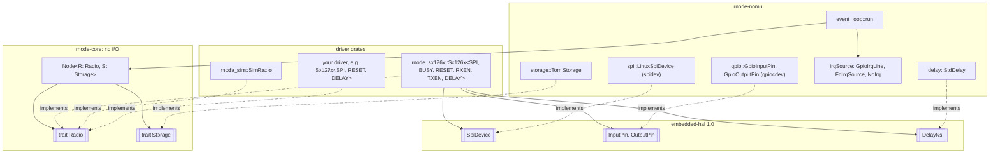
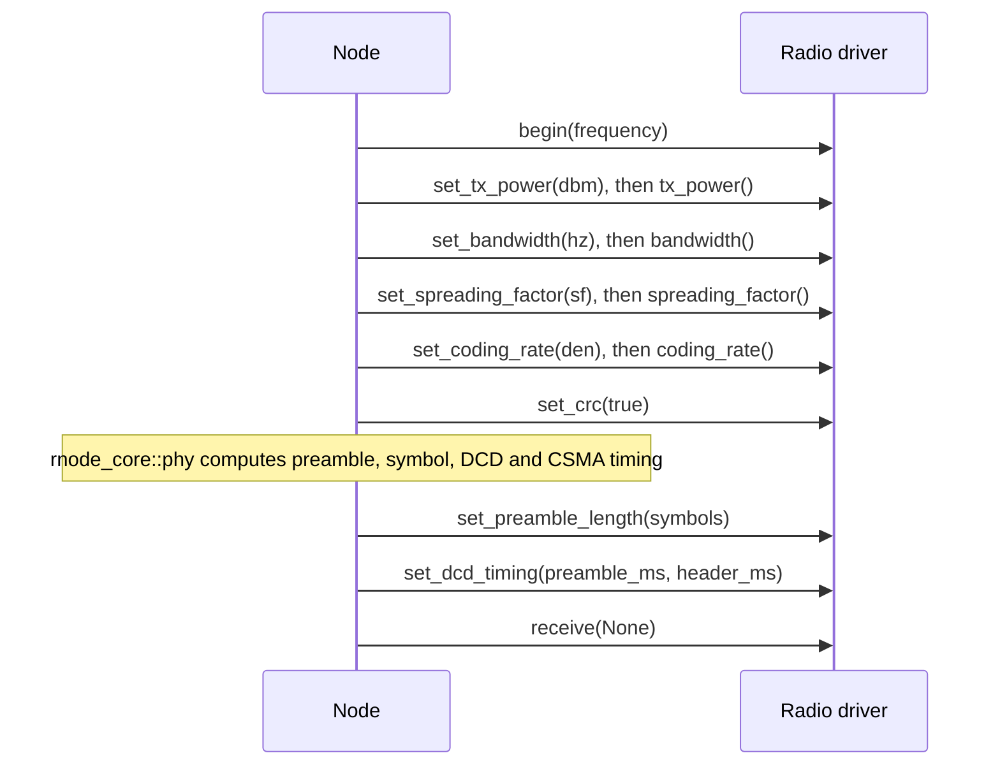
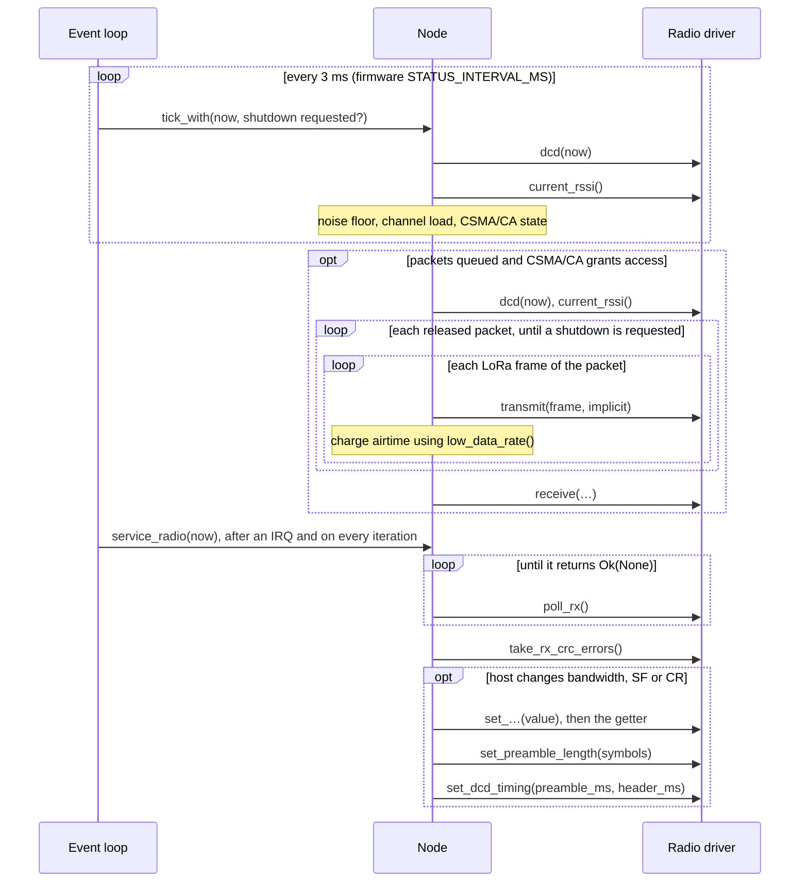
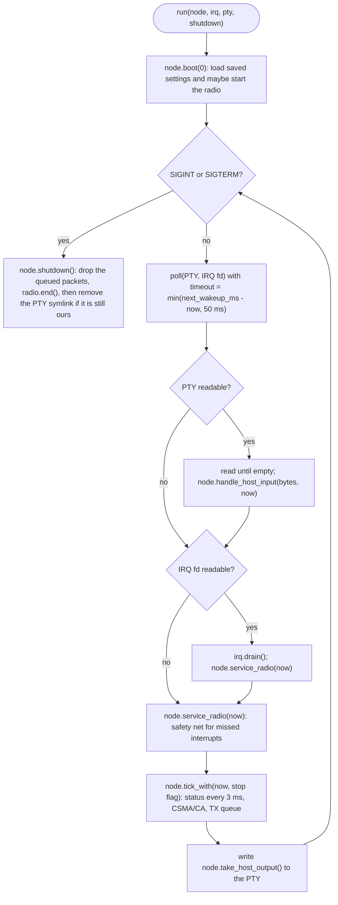
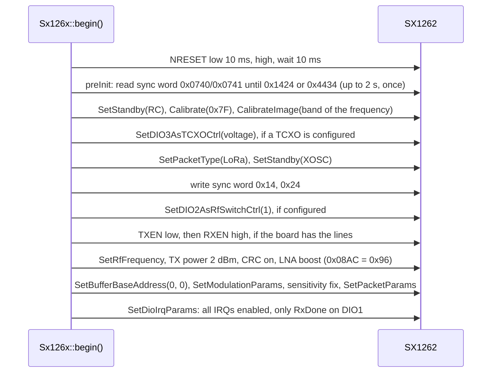

# Radio drivers

This guide explains why rnode-nomu separates radio drivers from the rest of the code, what the
`rnode_core::Radio` trait expects from a driver, and how to add support for a new modem. The two
drivers in the workspace serve as worked examples:

- [`crates/rnode-sx126x`](../crates/rnode-sx126x): the real SX1262 driver, over `embedded-hal` SPI
  and GPIO;
- [`crates/rnode-sim`](../crates/rnode-sim): a simulated radio that talks to other simulated radios
  through Unix sockets.

## Contents

- [Why drivers](#why-drivers)
- [Architecture](#architecture)
- [Zero-cost dispatch with generics](#zero-cost-dispatch-with-generics)
- [The Radio trait](#the-radio-trait)
- [How Node drives a radio](#how-node-drives-a-radio)
- [Error handling](#error-handling)
- [Interrupts and the event loop](#interrupts-and-the-event-loop)
- [Carrier detect and DCD timing](#carrier-detect-and-dcd-timing)
- [External amplifiers](#external-amplifiers)
- [Worked example: rnode-sx126x](#worked-example-rnode-sx126x)
- [Worked example: rnode-sim](#worked-example-rnode-sim)
- [Testing a driver](#testing-a-driver)
- [Adding a new radio: an SX127x driver](#adding-a-new-radio-an-sx127x-driver)
- [Wiring a driver into the daemon](#wiring-a-driver-into-the-daemon)
- [Validating on hardware](#validating-on-hardware)
- [Common mistakes](#common-mistakes)

## Why drivers

All LoRa modems send the same kind of packets, but they are programmed very differently:

- The **SX1262** (SX126x family) takes opcodes with parameters over SPI, signals that it is busy on
  a BUSY pin, routes interrupts to DIO1, powers a TCXO from DIO3 and can drive the RF switch from
  DIO2.
- The **SX1276/SX1278** (SX127x family, also sold as RFM95/96/98 modules) is register-based, has no
  BUSY pin, signals RX done on DIO0, and chooses between two PA outputs with different power
  ranges.
- The **SX1280** works at 2.4 GHz with yet another command set and other bandwidths.

Boards add their own differences: TCXO or crystal, how the RF switch is driven, power amplifiers,
power rails. RNode_Firmware handles this with one modem class per chip family (`sx126x.cpp`,
`sx127x.cpp`, `sx128x.cpp`) and board definitions in `Boards.h`, all behind one interface that
the main loop calls.

rnode-nomu uses the same split:

| Layer | Where | Owns | Leaves alone |
| --- | --- | --- | --- |
| RNode logic | `rnode_core::Node` | KISS host protocol, TX queue, split framing, CSMA/CA, airtime, PHY parameters (preamble length, DCD timing), an external power amplifier's TX power mapping, statistics, saved settings | Anything chip-specific |
| Radio driver | a crate implementing `rnode_core::Radio` | Chip commands and registers, bandwidth quantisation, power and SF ranges, low-data-rate bit, RSSI and SNR conversion (including an LNA's gain), TX-done wait, IRQ flags, carrier detect | Protocol, queueing, retries, persistence |
| Platform | `rnode-nomu` | Config file, opening spidev and GPIO lines, IRQ file descriptors, PTY, settings file, event loop, choosing the driver | Protocol and chip decisions |

A new modem therefore needs one new crate and a few lines of daemon wiring. Nothing in
`rnode-core` changes, and the protocol behaviour that Reticulum and other RNodes see stays the
same.

## Architecture



A hardware driver depends only on `rnode-core` and the `embedded-hal` 1.0 traits, never on Linux.
The daemon supplies Linux implementations of those traits. The same driver could therefore run on
another platform with other HAL implementations, and its tests run against mock HAL objects on any
machine.

## Zero-cost dispatch with generics

`Node` is generic over its radio and its storage, and the event loop over the IRQ source:

```rust
pub struct Node<R: Radio, S: Storage> { /* … */ }

pub fn run<R, S, I>(node: Node<R, S>, irq: I, pty: PtyPair, shutdown: &AtomicBool) -> Result<(), EventLoopError>
where
    R: Radio,
    S: Storage,
    I: IrqSource,
{
    /* … */
}
```

The daemon chooses the driver once, at startup, from `radio.driver` in the config
(`crates/rnode-nomu/src/main.rs`):

```rust
match config.radio.driver {
    RadioDriver::Sx1262 => run_sx1262(config, spilog, seed, &shutdown),
    RadioDriver::Sim => run_sim(config, seed, &shutdown),
}
```

Each arm builds a different concrete type and calls the same generic event loop:

```rust
// run_sx1262, abridged
let spi = LinuxSpiDevice::open(&spi_config.device, spi_config.speed_hz, recorder)?;
let gpio = RadioGpio::open(gpio_config)?;
let radio = Sx126x::new(spi, gpio.busy, gpio.reset, gpio.rxen, gpio.txen, StdDelay, radio_config);
let node = Node::new(radio, TomlStorage::new(path), node_config(&config), seed);
run(node, gpio.dio1, pty, shutdown)

// run_sim, abridged
let radio = SimRadio::new(sim_config)?;
let irq = FdIrqSource::new(radio.irq_fd().try_clone_to_owned()?);
let node = Node::new(radio, TomlStorage::new(path), node_config(&config), seed);
run(node, irq, pty, shutdown)
```

The first `node` is a
`Node<Sx126x<LinuxSpiDevice, GpioInputPin, GpioOutputPin, GpioOutputPin, GpioOutputPin, StdDelay>, TomlStorage>`
and the second a `Node<SimRadio, TomlStorage>`. The compiler generates the node and the event loop
once for each, so every `Radio` call is a direct call that can be inlined: there is no
`Box<dyn Radio>`, no vtable and no allocation. The same holds one level down: `Sx126x` is generic
over its SPI bus and pins, so `spi.transaction()` calls straight into `LinuxSpiDevice`. The price is
one copy of the node and the event loop per driver in the binary, which is small.

The only runtime decision is the `match` above. Keep driver selection there, at the edge of the
daemon, and out of `rnode-core`.

## The Radio trait

The trait is defined in
[`crates/rnode-core/src/radio.rs`](../crates/rnode-core/src/radio.rs):

```rust
pub trait Radio {
    type Error: fmt::Debug + fmt::Display;

    fn begin(&mut self, frequency_hz: u32) -> Result<(), Self::Error>;
    fn end(&mut self) -> Result<(), Self::Error>;

    fn set_frequency(&mut self, hz: u32) -> Result<(), Self::Error>;
    fn frequency(&self) -> u32;
    fn set_bandwidth(&mut self, hz: u32) -> Result<(), Self::Error>;
    fn bandwidth(&self) -> u32;
    fn set_spreading_factor(&mut self, sf: u8) -> Result<(), Self::Error>;
    fn spreading_factor(&self) -> u8;
    fn set_coding_rate(&mut self, denominator: u8) -> Result<(), Self::Error>;
    fn coding_rate(&self) -> u8;
    fn set_tx_power(&mut self, dbm: i8) -> Result<(), Self::Error>;
    fn tx_power(&self) -> i8;
    fn set_preamble_length(&mut self, symbols: u16) -> Result<(), Self::Error>;
    fn set_crc(&mut self, enabled: bool) -> Result<(), Self::Error>;
    fn low_data_rate(&self) -> bool;

    fn receive(&mut self, implicit_len: Option<u8>) -> Result<(), Self::Error>;
    fn transmit(&mut self, frame: &[u8], implicit: bool) -> Result<TxOutcome, Self::Error>;
    fn poll_rx(&mut self) -> Result<Option<RxFrame>, Self::Error>;
    fn take_rx_crc_errors(&mut self) -> RxCrcErrors {
        RxCrcErrors::default() // a driver that cannot tell reports none
    }

    fn dcd(&mut self, now_ms: u64) -> Result<bool, Self::Error>;
    fn current_rssi(&mut self) -> Result<i16, Self::Error>;
    fn set_dcd_timing(&mut self, preamble_ms: u32, header_ms: u32);
}

pub struct RxFrame {
    pub data: Vec<u8>,   // raw LoRa payload, at most 255 bytes, normally starting with the RNode header
    pub rssi_dbm: i16,   // packet RSSI in dBm (firmware packetRssi())
    pub snr_raw: u8,     // packet SNR, two's complement in 0.25 dB (firmware packetSnrRaw())
}

pub enum TxOutcome {
    Done,    // the modem reported TX done
    Timeout, // it did not, before the driver's timeout
}

pub struct RxCrcErrors {
    pub count: u32,               // frames poll_rx() dropped for a failed payload CRC since the last call
    pub last: Option<RxSignal>,   // RSSI and SNR of the last of them, if the driver read them
}

pub struct RxSignal {
    pub rssi_dbm: i16,
    pub snr_raw: u8,
}
```

The methods mirror the parts of the firmware's modem classes that `RNode_Firmware.ino` and
`Utilities.h` call. General rules:

- **Synchronous and single-threaded.** `Node` calls the driver from the event-loop thread through
  `&mut self`. A driver may block for waits the chip requires, such as BUSY or TX done, but while it
  blocks the daemon reads no host input and samples no channel status, so keep everything except
  `transmit()` short.
- **Setters act immediately.** A setter programs the chip at once and updates the driver's cached
  state. A getter returns the value actually in use, after the driver rounded or clamped the
  request. After a setter of the frequency, bandwidth, spreading factor, coding rate or TX power
  succeeds, `Node` reads the getter back and reports that value to the host, and Reticulum
  compares it with its own configuration. If the setter fails, `Node` reports the value the
  modem last accepted instead; see [Error handling](#error-handling).
- **Exact on-air behaviour.** Register values, sync word, CRC, IQ, preamble and low-data-rate
  optimisation must match what RNode_Firmware programs for the same chip, or real RNodes will not
  hear you. Cite the firmware function you followed in each method's doc comment.
- **No policy.** Queueing, retries, splitting, CSMA/CA and KISS replies belong to `Node`.

| Method | `Node` calls it | Firmware counterpart | Contract |
| --- | --- | --- | --- |
| `begin(frequency_hz)` | When the radio starts: the host turns it on, saved settings are loaded at startup, or after a reset | `begin()`, with `preInit()` | Reset and fully initialise the modem for LoRa at that frequency: chip detection, calibration, TCXO, packet type, sync word, RF switch, default power, CRC, LNA, FIFO bases, modulation, packet parameters, interrupt routing. Leave it in standby |
| `end()` | Radio off, daemon shutdown, before a reset | `end()` | Put the modem to sleep. `begin()` comes before any further use |
| `set_frequency(hz)` / `frequency()` | `CMD_FREQUENCY` while the radio is on | `setFrequency()` | Program the carrier frequency. Before startup the frequency arrives through `begin()` |
| `set_bandwidth(hz)` / `bandwidth()` | Radio start, `CMD_BANDWIDTH` while on | `setSignalBandwidth()` / `getSignalBandwidth()` | Round up to the nearest supported bandwidth; update the low-data-rate bit; the getter returns the rounded value |
| `set_spreading_factor(sf)` / `spreading_factor()` | Radio start, `CMD_SF` while on | `setSpreadingFactor()` | Clamp to the chip's range (`Node` already limits it to 5–12); update the low-data-rate bit |
| `set_coding_rate(den)` / `coding_rate()` | Radio start, `CMD_CR` while on | `setCodingRate4()` | Coding rate 4/`den`, `den` from 5 to 8 |
| `set_tx_power(dbm)` / `tx_power()` | Radio start, `CMD_TXPOWER` while on | `setTxPower()` | Clamp to the chip's or board's range. `Node` passes 0 dBm up to `NodeConfig::max_tx_power` (22 by default), since the host's power byte is unsigned as in the firmware. With an external PA it passes the modem output the PA's gain table gives, which can be negative; see [External amplifiers](#external-amplifiers). The getter returns the power in use |
| `set_preamble_length(symbols)` | After every bandwidth, SF or CR change; after a failure, again before each transmission and each `receive()` until it succeeds | `setPreambleLength()` | Program the preamble length that `rnode_core::phy::PhyParams` computed from the modulation (firmware `updateBitrate()`) |
| `set_crc(enabled)` | Radio start, always with `true` | `enableCrc()` / `disableCrc()` | Payload CRC on or off |
| `low_data_rate()` | When charging airtime after each frame | global `lora_low_datarate`, set by `handleLowDataRate()` | Whether low-data-rate optimisation is on. Decide it with `rnode_core::phy::low_data_rate()`, the firmware's integer expression, and program the same value into the chip |
| `receive(implicit_len)` | Radio start, after every TX burst, `CMD_PROMISC`, `CMD_IMPLICIT` | `receive()` | Enter continuous receive. `None` selects explicit headers; `Some(n)` implicit headers with payload length `n` (only used in promiscuous mode) |
| `transmit(frame, implicit)` | For each LoRa frame when CSMA/CA allows | `beginPacket()`, `write()`, `endPacket()` | Send one frame of at most 255 bytes, RNode header included, and block until TX done or the driver's timeout. Leave the modem in standby; `Node` calls `receive()` afterwards |
| `poll_rx()` | After every IRQ, and on every event-loop iteration while the radio is on | `handleDio0Rise()` and the reads in `receive_callback()` | If a packet arrived, read it with its RSSI and SNR, clear the interrupt and return it. Drop CRC failures as `Ok(None)` and count them for `take_rx_crc_errors()`. With nothing pending, return `Ok(None)` without side effects. Report the RSSI at the antenna: less the gain of an LNA before the modem, if the board has one |
| `take_rx_crc_errors()` | After each `poll_rx()` loop | none: `handleDio0Rise()` drops CRC failures without a trace | Return how many frames `poll_rx()` dropped for a failed CRC since the last call, with the RSSI and SNR of the last one if you read them, and reset the count. `Node` logs them at `debug`. Optional: the default reports none |
| `dcd(now_ms)` | Every 3 ms while on, and before each TX decision | `dcd()` | Whether a LoRa preamble or header is being received right now |
| `current_rssi()` | Every 3 ms while on, and before each TX decision | `currentRssi()` | Channel RSSI in dBm at the antenna: less the gain of an LNA before the modem, if the board has one |
| `set_dcd_timing(preamble_ms, header_ms)` | After every bandwidth, SF or CR change | globals `lora_preamble_time_ms`, `lora_header_time_ms` | Timing for expiring stale preamble detections; see [below](#carrier-detect-and-dcd-timing). Ignore it if your carrier detect does not need it |

Two details that are easy to get wrong:

- `transmit()` receives complete LoRa frames. `Node` has already prepended the RNode header byte
  (random sequence number in the high nibble, split flag in bit 0) and cut packets over 254 bytes
  into two frames. Send the bytes as they are.
- `poll_rx()` returns the raw frame, header byte included. `Node` reassembles split packets,
  strips the header and reports RSSI and SNR to the host. Do not strip or interpret the header in
  the driver.

## How Node drives a radio

Starting the radio follows the firmware's `startRadio()`:



While the radio is on:



`Node` takes the radio offline with `end()` on `CMD_RADIO_STATE` off, on `CMD_RESET`, after a
modem TX timeout and when the daemon shuts down. The event loop calls `tick_with(now, should_stop)`
rather than `tick(now)`, so that a burst ends before the next packet once SIGTERM has arrived;
`Node::shutdown()` then drops what is still queued and calls `end()`.

## Error handling

Every fallible method returns `Result<_, Self::Error>`. The error type needs `Debug` and
`Display`; the `Display` text ends up in the operator's log, so make it say what failed, for
example `SX126x BUSY timeout` or `SPI error: …`. `Node` never panics on a driver error. It logs the
error at `WARN`, tells the host where the firmware would, and carries on:

| Failure | What `Node` does |
| --- | --- |
| `begin()` returns `Err` | Logs `radio begin failed: …`, sends `CMD_ERROR` `ERROR_INITRADIO` and reports the radio as off. The host may retry |
| `set_frequency()`, `set_bandwidth()`, `set_spreading_factor()`, `set_coding_rate()` or `set_tx_power()` returns `Err` | Keeps the value the modem last accepted, the one it last read back: logs `radio set_bandwidth(250 kHz) failed: …; keeping 125 kHz`, calls the setter again with the kept value, leaves the PHY parameters, airtime, CSMA and DCD timing as they were, sends no `CMD_STAT_PHYPRM` and echoes the kept value, so the host sees that the radio did not take its setting. If the second call fails too, it logs `radio set_bandwidth(125 kHz) failed while restoring it: …`. While the radio comes online, the kept value is what `begin()` programmed, as the getter reports it then |
| `set_preamble_length()` returns `Err` | Keeps the PHY parameters of the new modulation, which the modem now uses: `CMD_STAT_PHYPRM`, DCD timing, CSMA and airtime follow it. Calls `set_preamble_length()` again before each transmission and each time it re-enters receive, until a call succeeds; until then the modem may send the previous preamble length. Logs `radio set_preamble_length failed: …`, rate-limited, and `radio set_preamble_length recovered after …` once a call works |
| `set_crc()` or `receive()` returns `Err` | Logs `radio operation failed: …` and carries on |
| `transmit()` returns `Err` | Logs `radio transmit failed: …`, sends `ERROR_TXFAILED` and drops the packet, including any frame not yet sent. The rest of the queue waits for the next channel access |
| `transmit()` returns `Ok(TxOutcome::Timeout)` | Sends `ERROR_MODEM_TIMEOUT` and `ERROR_TXFAILED` and hard-resets like the firmware: `end()`, empties the queue, reloads the saved settings and, if there are any, calls `begin()` again |
| `poll_rx()` returns `Err` | Logs `radio RX service failed: …` and tries again on the next iteration |
| `dcd()` or `current_rssi()` returns `Err` | Logs `radio DCD failed: …` or `radio RSSI failed: …` and skips that status sample. No TX happens until a sample succeeds, because CSMA/CA needs a fresh observation |
| `end()` returns `Err` | Logs it and treats the radio as off anyway |

`dcd()`, `current_rssi()` and `poll_rx()` run every few milliseconds, so their errors are
rate-limited: the first failure is logged at `WARN`, then at most one summary every 10 s with the
count and the latest error, and an `INFO` line once the call has worked for 10 s. A failing
`set_preamble_length()` is retried before every transmission and receive, and is logged the same
way, except that its `INFO` line comes with the first call that works. The other calls are rare
and log every failure.

Guidelines for driver authors:

- **Bound every wait.** A stuck BUSY line, a mode that never becomes ready or a TX-done flag that
  never comes must end in an error or `TxOutcome::Timeout`, never in a hang. The SX1262 driver
  bounds BUSY waits by `busy_timeout_ms` and TX by an airtime-based limit.
- **`Timeout` and `Err` mean different things.** `Timeout` means the modem took the frame but never
  reported TX done; the frame may or may not have gone out, and `Node` resets as the firmware does.
  `Err` means the driver could not talk to the modem; `Node` drops the packet and keeps running.
- **A failed setter may leave your cache changed.** A setter that fails half-way, after updating
  the driver's cached value or after the modem took part of the command, need not undo anything:
  `Node` calls it again with the value the modem last accepted. What the getters must get right is
  the value in use after a successful call, and after `begin()` the values it programmed.
- **A CRC failure is not an error.** Clear the interrupt and return `Ok(None)`, as the firmware
  drops the packet. Count it for `take_rx_crc_errors()`, so that the operator can tell a frame
  that arrived corrupted from one that never arrived.
- **Map HAL errors** into your error type. `rnode-sx126x` wraps SPI errors as `Error::Spi(e)` and
  turns pin errors into `Error::Digital(kind)`, so its error type does not depend on the pin types.
- **Do not panic** on anything the hardware can do. Assertions are only for programming errors,
  such as a command buffer that is too small.
- **Do not log errors you return.** `Node` logs them. Use `log::debug!` for diagnostics that have
  no other outlet, as `rnode-sim` does for malformed datagrams.

## Interrupts and the event loop

The daemon's event loop,
[`crates/rnode-nomu/src/event_loop.rs`](../crates/rnode-nomu/src/event_loop.rs), waits for three
things with one `poll()`: bytes from the host on the PTY, the modem's interrupt, and the node's next
wake-up time.



The interrupt reaches the loop through the `IrqSource` trait:

```rust
pub trait IrqSource {
    /// A descriptor that poll() reports readable when the modem has signalled, if there is one.
    fn fd(&self) -> Option<BorrowedFd<'_>>;
    /// Consume every pending event so that the descriptor is no longer readable.
    fn drain(&mut self) -> std::io::Result<()>;
}
```

| Implementation | Used by | Source of events |
| --- | --- | --- |
| `gpio::GpioIrqLine` | `sx1262` | Rising edges on the `[gpio] dio1` line, delivered by the kernel through the GPIO character device |
| `event_loop::FdIrqSource` | `sim` | Any readable descriptor, here `SimRadio::irq_fd()`, a socket the radio writes to when a frame arrives |
| `event_loop::NoIrq` | tests, or modems without an IRQ line | None; the loop relies on its wake-ups |

What this means for a driver:

- **The interrupt only wakes the loop.** The loop passes no data from the IRQ to the driver;
  `poll_rx()` reads the modem's own status, and must cope with being called when nothing happened.
  It runs on every loop iteration, roughly every 3 ms, so make the idle path a single cheap status
  read.
- **Route only RX done to the IRQ pin.** TX done is polled inside `transmit()`, and preamble and
  header detection are read by `dcd()`. The SX1262 driver routes only RxDone to DIO1
  (`SetDioIrqParams`); an SX127x routes RxDone to DIO0 (`REG_DIO_MAPPING_1 = 0x00`).
- **A driver works without an interrupt.** Because `service_radio()` also runs on every iteration
  and the loop wakes every 3 ms while the radio is on, a missing or misconfigured IRQ line costs at
  most a few milliseconds of latency. This is also the safety net against an interrupt line that
  stays high and therefore produces no further edges.
- **`transmit()` blocks the loop** for the frame's airtime and longer for a burst. Host bytes wait
  in the PTY meanwhile. A shutdown request waits for the packet on the air, both frames of a split
  packet, because `tick_with()` checks it only between packets; at SF12 and 7.8 kHz one 255-byte
  frame takes about 147 s (issue #59).

## Carrier detect and DCD timing

CSMA/CA trusts `dcd()`: while it returns `true` the channel is busy and nothing is sent, and its
samples also make up the channel utilisation reported to the host in `CMD_STAT_CHTM`. A carrier
detect that sticks at `true` stops the node from transmitting; one that misses carriers makes it
transmit over other nodes.

The SX1262 reports a detected preamble with a latched interrupt flag. Noise sometimes looks like a
preamble and is never followed by a header, which would leave carrier detect on forever. The
firmware's `sx126x::dcd()` therefore expires a preamble detection that is older than the
preamble time plus the header time, clears the flag and restarts reception. Those two times depend
on the modulation; `rnode_core::phy::PhyParams` computes them as the firmware's `updateBitrate()`
does, and `Node` hands them to the driver with `set_dcd_timing(preamble_ms, header_ms)` whenever the
bandwidth, spreading factor or coding rate changes.

```text
preamble flag  ____|‾‾‾‾‾‾‾‾‾‾‾‾‾‾‾‾‾‾‾‾‾‾‾‾‾‾‾‾‾‾‾‾‾|_________    no header follows
dcd()              true ………………………………………………………… true  false
                   |<---- preamble_ms + header_ms ---->|
                   first seen                           expired: clear flag, receive() again
```

`now_ms` is the event loop's monotonic clock, the same one `Node` uses for CSMA/CA. Drivers whose
carrier detect is a live status rather than a latched flag can ignore the timing: the firmware's
`sx127x::dcd()` reads the SX127x's "signal detected" and "signal synchronised" bits, and `rnode-sim`
derives carrier detect from the carrier records of other simulated radios. Both implement
`set_dcd_timing()` as a no-op.

## External amplifiers

Some boards put a power amplifier (PA) between the modem and the antenna, and a low-noise amplifier
(LNA) in front of the modem on receive; RNode_Firmware calls them `HAS_LORA_PA` and `HAS_LORA_LNA`.
The work splits as it does in the firmware:

| Part | Where | Firmware |
| --- | --- | --- |
| Mapping the host's TX power, the power after the PA, to a modem output, and the modem output back to the power reported to the host | `rnode_core::pa::ExternalPa`, applied by `Node` when `NodeConfig::external_pa` is set | `map_target_power_to_modem_output()`, `map_modem_output_to_target_power()` and `setTXPower()` in `Utilities.h`, common code |
| Clamping `CMD_TXPOWER` to the PA's maximum output | `Node`, with `NodeConfig::max_tx_power` | `serial_callback()`: `PA_MAX_OUTPUT` |
| Subtracting the LNA's gain from every RSSI | the driver: `rnode_sx126x::Config::lna_gain_db` | `sx126x::currentRssi()`, `packetRssi()`: `lora_lna_gain` |
| Leaving RSSI samples more than 12 dB below the noise floor out of it | `Node`, when `NodeConfig::external_lna` is set | `update_noise_floor()`: `LORA_LNA_GVT` |
| Switching the PA to transmit and back | the driver: `Sx126x`'s TXEN line | `beginPacket()`, `receive()`: `LORA_PA_CTX`; `sleep_now()` |

For a driver this means:

- **`set_tx_power()` gets modem outputs.** With a PA, `Node` passes the modem output the gain table
  maps the host's power to. Below the PA's minimum that is negative (−11 dBm for 0 dBm through the
  GC1109), and it can lie outside your modem's range: clamp it, as for any request, and report the
  clamped value from `tx_power()`. `Node` maps the value it reads back to the power after the PA, so
  a clamp at the modem's limit shows up in what the host is told. The firmware maps back the modem
  output it asked for; the two agree whenever the gain table has no entry beyond the modem's limit,
  as for the SX1262 with the firmware's tables.
- **RSSI is measured at the antenna.** If the board has an LNA, subtract its gain from the channel
  RSSI, the packet RSSI and the signal of CRC-failed frames, as `rnode-sx126x` does with
  `Config::lna_gain_db`. The SNR is a ratio and stays as it is.
- **A TX enable goes with the transmission.** If the PA or the RF switch has a TX-enable input
  that the modem does not drive itself (through DIO2 on the SX1262), drive it high before the
  transmission's first command, keep it high through the frames of a burst, and drive it low when
  entering receive and after putting the modem to sleep. With an RX-enable line too, never have
  both high: lower one before raising the other. If the line cannot be lowered in `end()`, report
  that even when the sleep command failed too: `rnode-sx126x` returns both errors in
  `Error::SleepAndTxen`.
- **The rest is board wiring.** PA enable lines, and telling one PA from another as the firmware
  does on the Heltec V4, belong to the platform or to the driver's configuration; the daemon
  ports neither.

The daemon fills all of this from [`[radio.pa]`](configuration.md#radiopa), which also lists what is
not ported, and the TX enable from [`[gpio] txen`](configuration.md#gpio).

## Worked example: rnode-sx126x

[`crates/rnode-sx126x/src/lib.rs`](../crates/rnode-sx126x/src/lib.rs) is the template for hardware
drivers. It mirrors RNode_Firmware v1.86 `sx126x.cpp` and cites the firmware function above each
method.

**Types.** The driver is generic over the `embedded-hal` 1.0 traits and has no Linux dependency:

```rust
pub struct Sx126x<SPI, BUSY, RESET, RXEN, TXEN, DELAY> { /* … */ }

impl<SPI: SpiDevice, BUSY: InputPin, RESET: OutputPin, RXEN: OutputPin, TXEN: OutputPin, DELAY: DelayNs>
    Sx126x<SPI, BUSY, RESET, RXEN, TXEN, DELAY>
{
    pub fn new(
        spi: SPI,
        busy: BUSY,
        reset: RESET,
        rxen: Option<RXEN>,
        txen: Option<TXEN>,
        delay: DELAY,
        config: Config,
    ) -> Self {
        /* … */
    }
}

pub struct Config {
    pub tcxo: Option<TcxoVoltage>, // DIO3 TCXO supply, firmware enableTCXO()
    pub dio2_as_rf_switch: bool,   // firmware setDio2AsRfSwitchCtrl()
    pub ocp: u8,                   // firmware OCP_TUNED
    pub busy_timeout_ms: u32,      // firmware waitOnBusy()
    pub tx_timeout_ms: u32,        // floor for the TX-done wait, firmware LORA_MODEM_TIMEOUT_MS
    pub lna_gain_db: u8,           // LNA before the modem, firmware lora_lna_gain
}
```

Boards without an RX-enable or a TX-enable line pass `None::<NoPin>` for it. The daemon fills
`Config` from
`[radio.sx1262]`, and `lna_gain_db` from `[radio.pa]`, with `RadioConfig::sx1262_driver_config()`.

**Bus access.** Every SPI transaction first waits for BUSY to go low, as the firmware's
`waitOnBusy()` does, and a few helpers wrap the command formats: `execute_opcode()`,
`execute_opcode_read()`, `read_register()`, `write_register()`, `read_buffer()` and
`write_buffer()`.

**Startup.** `begin()` sends the firmware's sequence:



**Deliberate differences**, documented in the crate:

- Every TCXO voltage uses the SX1262 datasheet encoding; the firmware's board constants map 2.4 V
  and 2.7 V to the 3.0 V setting, which the firmware never selects.
- The TX-done wait is `max(tx_timeout_ms, 2 × airtime + 1000 ms)` instead of a fixed 20 s, which
  would abort valid long frames at SF12 and narrow bandwidths.
- `wait_on_busy()` returns `Error::BusyTimeout` where the firmware carries on after 100 ms.
- `dcd()` forgets a preamble detection once the flag clears, so that a completed short packet
  cannot make the next packet's preamble look stale.
- `poll_rx()` reads the packet status (`GetPacketStatus`) of a frame that failed its CRC, for
  `take_rx_crc_errors()`; the firmware reads nothing more for such a frame. Good frames get no
  extra transaction.
- With `lna_gain_db`, the packet RSSI is compensated like the channel RSSI. The firmware's ESP32
  builds, the Heltec V4 among them, read it with `packetRssi(uint8_t)`, which leaves the LNA's gain
  in.
- With both RXEN and TXEN, RXEN goes low before TXEN goes high, and TXEN low before RXEN goes high,
  so that the RF switch is never asked for both paths. The firmware's SX1262 driver has no TXEN and
  never drives RXEN low, which the driver keeps when TXEN is absent; the firmware's SX1280 driver
  raises TXEN before it lowers RXEN.

**Tests.** [`crates/rnode-sx126x/src/tests.rs`](../crates/rnode-sx126x/src/tests.rs) checks the
exact bytes of every command against the firmware with a mocked bus; see
[Testing a driver](#testing-a-driver).
[`crates/rnode-sx126x/tests/rf_switch.rs`](../crates/rnode-sx126x/tests/rf_switch.rs) logs the SPI
commands and the levels of RXEN and TXEN in one sequence, to pin where the lines switch.

## Worked example: rnode-sim

[`crates/rnode-sim/src/lib.rs`](../crates/rnode-sim/src/lib.rs) implements the same trait with no
hardware at all, which shows how little of the trait is about SPI:

- `SimRadio::new(SimConfig)` binds the Unix datagram socket `<air_dir>/<node_name>.sock` and starts
  a worker thread that receives what other simulated radios send.
- `transmit()` computes the Semtech time on air for the frame, sends a carrier-start record to every
  other socket in `air_dir`, sleeps for the time on air, sends the frame record and returns
  `TxOutcome::Done`. Like a real modem it blocks for the frame's airtime.
- The worker accepts a frame only if the radio was awake and receiving for the whole frame, was not
  transmitting, and uses the sender's frequency, bandwidth, spreading factor and low-data-rate
  setting. Overlapping receivable carriers collide and both frames are lost; `loss` drops frames at
  random, and `crc_error` turns them into CRC failures, counted for `take_rx_crc_errors()`.
- Accepted frames are queued, and the worker writes a byte to a socket pair, also for a CRC failure.
  Its other end, `SimRadio::irq_fd()`, is what the daemon wraps in `FdIrqSource`, and `poll_rx()`
  pops the queue.
- `dcd()` is true while a receivable carrier is on the air, `current_rssi()` reports the configured
  RSSI during a carrier and −110 dBm otherwise, and `set_dcd_timing()` does nothing.

`rnode-core` has a third, much smaller radio for unit tests: `rnode_core::sim::SimRadio`, behind the
`sim` feature. It runs on a virtual clock (`SimMedium::advance_ms()`) and can inject failures and
frames: `inject_begin_failures()`, `inject_next_tx_error()`, `inject_next_timeout()`,
`inject_dcd_errors()`, `inject_rssi_errors()`, `inject_rx_errors()`, `inject_setter_errors()`,
`inject_preamble_length_errors()`, `inject_rx()` and `inject_rx_crc_error()`, and it can clamp the
TX power like a modem with `set_tx_power_range()`. Each injected failure is the worst case for
`Node`: a setter failure from `inject_setter_errors()` applies the value before it fails, so `Node`
has to put the old one back, while a preamble-length failure leaves the old length, so `Node` has to
try again. Use it to test how `Node` reacts to driver behaviour without writing a mock radio, as the
tests in [`crates/rnode-core/tests`](../crates/rnode-core/tests) do.

## Testing a driver

Test a driver against mock `embedded-hal` objects first and against hardware second. The SX1262
tests show the pattern.

**A recording SPI mock.** It logs every transaction and returns queued bytes for reads:

```rust
#[derive(Debug, Clone, PartialEq, Eq)]
enum OpLog {
    Write(Vec<u8>),
    Read(usize),
}

#[derive(Debug, Default)]
struct MockSpiState {
    log: Vec<Vec<OpLog>>,       // one entry per transaction
    reads: VecDeque<Vec<u8>>,   // bytes to return for the next reads
}

#[derive(Debug, Clone, Default)]
struct MockSpi(Rc<RefCell<MockSpiState>>);

impl embedded_hal::spi::ErrorType for MockSpi {
    type Error = Infallible;
}

impl SpiDevice for MockSpi {
    fn transaction(&mut self, operations: &mut [Operation<'_, u8>]) -> Result<(), Self::Error> {
        let mut tx = Vec::new();
        for op in operations {
            match op {
                Operation::Write(bytes) => tx.push(OpLog::Write(bytes.to_vec())),
                Operation::Read(buf) => {
                    tx.push(OpLog::Read(buf.len()));
                    let data = self.0.borrow_mut().reads.pop_front().unwrap_or_else(|| vec![0; buf.len()]);
                    for (dst, src) in buf.iter_mut().zip(data) {
                        *dst = src;
                    }
                }
                // Transfer, TransferInPlace, DelayNs: record as needed
                _ => {}
            }
        }
        self.0.borrow_mut().log.push(tx);
        Ok(())
    }
}
```

The `Rc<RefCell<…>>` lets the test keep a clone of the mock after moving the original into the
driver. Pins and the delay are mocked the same way: `MockInput` returns a scripted sequence of BUSY
levels, `MockOutput` records the levels written to RESET, RXEN and TXEN, and `MockDelay` records
every delay. Where the order of line changes and commands matters, as for the RF switch lines, log
both in one sequence.

**Golden values from the firmware.** Assert the exact bytes the firmware sends, not values computed
with your own helpers:

```rust
#[test]
fn begin_sequence_with_tcxo_dio2_and_rxen() {
    let (mut radio, spi, reset, rxen) = dev(Config { tcxo: Some(TcxoVoltage::V1_8), ..Config::default() });
    spi.push(&[0x14]); // sync word MSB: chip detected
    spi.push(&[0x24]); // sync word LSB
    radio.begin(868_000_000).unwrap();
    assert_eq!(*reset.levels.borrow(), vec![false, true]);
    assert_eq!(*rxen.levels.borrow(), vec![true]);
    assert!(has_seq(&spi, &[0x97, 0x02, 0x00, 0x00, 0xff])); // SetDIO3AsTCXOCtrl 1.8 V
    assert!(has_seq(&spi, &[0x86, 0x36, 0x40, 0x00, 0x00])); // SetRfFrequency 868 MHz
    assert!(has_seq(&spi, &[0x08, 0xff, 0xff, 0x00, 0x02, 0x00, 0x00, 0x00, 0x00])); // RxDone on DIO1
}
```

The value `0x36400000` is 868 MHz in the firmware's `setFrequency()` arithmetic. A test that only
checked that `frequency()` returns what `set_frequency()` was given would pass for a driver that
programs the wrong register.

**What to cover:**

- the `begin()` sequence for each board option (TCXO or not, RF switch, RX and TX enable);
- where the RF switch lines change around transmit, receive and sleep;
- frequency encoding for frequencies in each band you support;
- every bandwidth step, and the spreading factor and coding rate clamps;
- the low-data-rate decision at its boundaries (it must equal `rnode_core::phy::low_data_rate()`);
- preamble and packet parameter writes;
- RSSI and SNR conversion from raw register bytes;
- FIFO writes and reads, frames of 255 bytes, and clearing interrupts;
- the CRC-error path of `poll_rx()` (`Ok(None)`, counted by `take_rx_crc_errors()`) and its idle
  path;
- TX done, TX timeout and the timeout limit;
- error paths: a failing SPI bus, a failing pin, a BUSY line stuck high, a chip that is not
  detected;
- carrier detect, including stale-preamble expiry if your chip latches it.

Unit tests that need private access go in `src/tests.rs` next to `lib.rs`, as
[AGENTS.md](../AGENTS.md) describes; tests through the public API go in `tests/<topic>.rs`.

## Adding a new radio: an SX127x driver

This walk-through sketches a driver for the SX1276/SX1278, also sold as HopeRF RFM95/96/98
modules, following RNode_Firmware's `sx127x.cpp`. The code shows the shape of the driver and the
firmware values to start from. It is not a finished driver: verify every value against the
firmware and the datasheet, and test it as described above.

### 1. Read the firmware

Before writing Rust, read the firmware's driver and its call sites:

- `sx127x.h` and `sx127x.cpp`: registers, `begin()`, `setFrequency()`, `setSignalBandwidth()`,
  `setTxPower()`, `handleLowDataRate()`, `dcd()`, `packetRssi()`, `handleDio0Rise()`;
- `Boards.h`: which pins and PA output each board uses;
- `RNode_Firmware.ino` and `Utilities.h`: how `startRadio()`, `transmit()`, `receive_callback()`
  and the status code call the driver.

Note where the SX127x differs from the SX1262: the spreading factor range is 6–12, not 5–12, TX
power depends on the PA output (PA_BOOST 2–17 dBm, RFO 0–14 dBm), the preamble register holds the
length minus 4, packet RSSI depends on the band and the SNR, and there is no BUSY pin. Also check
that the shared code fits: `rnode_core::phy::airtime_ms()` follows the SX1262 branch of the
firmware's `add_airtime()`, which differs from the SX127x branch below SF7. Extend `phy` if you
port a difference like that, rather than working around it in the driver.

### 2. Create the crate

Add `crates/rnode-sx127x`. The workspace includes every directory under `crates/`, so no root
`Cargo.toml` change is needed:

```toml ignore
[package]
name = "rnode-sx127x"
version.workspace = true
edition.workspace = true
rust-version.workspace = true
license.workspace = true
repository.workspace = true
description = "Portable embedded-hal SX127x driver for RNode"

[lints]
workspace = true

[dependencies]
embedded-hal = "1.0"
rnode-core = { path = "../rnode-core" }
```

Keep dependencies small: the crate should stay usable on small boards.

### 3. Define the board configuration and the error type

Link parameters (frequency, bandwidth, spreading factor, coding rate, power) come from the host
through `Node`. The driver's `Config` describes only the board:

```rust
use core::fmt;

use embedded_hal::delay::DelayNs;
use embedded_hal::digital::OutputPin;
use embedded_hal::spi::{Operation, SpiDevice};
use rnode_core::phy;
use rnode_core::radio::{Radio, RxCrcErrors, RxFrame, TxOutcome};

/// Board-specific SX127x options.
#[derive(Debug, Clone, PartialEq, Eq)]
pub struct Config {
    /// Firmware `setTxPower(level, PA_OUTPUT_PA_BOOST_PIN)`; `false` uses the RFO output.
    pub pa_boost: bool,
    /// Longest TX-done wait in ms. The firmware's `endPacket()` waits forever; a driver must not.
    pub tx_timeout_ms: u32,
}

#[derive(Debug, Clone, PartialEq, Eq)]
pub enum Error<Spi> {
    Spi(Spi),
    Reset,
    NotDetected,
}

impl<Spi: fmt::Display> fmt::Display for Error<Spi> {
    fn fmt(&self, f: &mut fmt::Formatter<'_>) -> fmt::Result {
        match self {
            Self::Spi(e) => write!(f, "SPI error: {e}"),
            Self::Reset => f.write_str("SX127x reset line error"),
            Self::NotDetected => f.write_str("SX127x not detected"),
        }
    }
}
```

### 4. Write the driver type and register access

The SX127x has no BUSY line. Its RX-done interrupt, DIO0, is watched by the daemon's event loop, so
the driver itself needs only the bus, the reset line and a delay:

```rust
// Registers and values from sx127x.cpp.
const REG_FIFO: u8 = 0x00;
const REG_OP_MODE: u8 = 0x01;
const REG_FRF_MSB: u8 = 0x06;
const REG_FRF_MID: u8 = 0x07;
const REG_FRF_LSB: u8 = 0x08;
const REG_PA_CONFIG: u8 = 0x09;
const REG_LNA: u8 = 0x0c;
const REG_FIFO_ADDR_PTR: u8 = 0x0d;
const REG_FIFO_TX_BASE_ADDR: u8 = 0x0e;
const REG_FIFO_RX_BASE_ADDR: u8 = 0x0f;
const REG_FIFO_RX_CURRENT_ADDR: u8 = 0x10;
const REG_IRQ_FLAGS: u8 = 0x12;
const REG_RX_NB_BYTES: u8 = 0x13;
const REG_MODEM_STAT: u8 = 0x18;
const REG_PKT_SNR_VALUE: u8 = 0x19;
const REG_PKT_RSSI_VALUE: u8 = 0x1a;
const REG_RSSI_VALUE: u8 = 0x1b;
const REG_MODEM_CONFIG_1: u8 = 0x1d;
const REG_MODEM_CONFIG_2: u8 = 0x1e;
const REG_PAYLOAD_LENGTH: u8 = 0x22;
const REG_MODEM_CONFIG_3: u8 = 0x26;
const REG_SYNC_WORD: u8 = 0x39;
const REG_DIO_MAPPING_1: u8 = 0x40;
const REG_VERSION: u8 = 0x42;
const REG_PA_DAC: u8 = 0x4d;

const MODE_LONG_RANGE: u8 = 0x80;
const MODE_SLEEP: u8 = 0x00;
const MODE_STDBY: u8 = 0x01;
const MODE_TX: u8 = 0x03;
const MODE_RX_CONTINUOUS: u8 = 0x05;
const IRQ_TX_DONE: u8 = 0x08;
const IRQ_PAYLOAD_CRC_ERROR: u8 = 0x20;
const IRQ_RX_DONE: u8 = 0x40;
const SIG_DETECT: u8 = 0x01;
const SIG_SYNCED: u8 = 0x02;
const SYNC_WORD: u8 = 0x12;
const RSSI_OFFSET: i16 = 157;

/// Bandwidths of `setSignalBandwidth()`, indexed by the register code.
const BANDWIDTHS: [u32; 10] = [7_800, 10_400, 15_600, 20_800, 31_250, 41_700, 62_500, 125_000, 250_000, 500_000];

#[derive(Debug)]
pub struct Sx127x<SPI, RESET, DELAY> {
    spi: SPI,
    reset: RESET,
    delay: DELAY,
    config: Config,
    frequency: u32,
    bw_code: u8,
    sf: u8,
    cr: u8,
    tx_power: i8,
    ldro: bool,
    implicit: bool,
    preinit_done: bool,
    crc_errors: RxCrcErrors,
}

impl<SPI: SpiDevice, RESET: OutputPin, DELAY: DelayNs> Sx127x<SPI, RESET, DELAY> {
    pub fn new(spi: SPI, reset: RESET, delay: DELAY, config: Config) -> Self {
        Self {
            spi,
            reset,
            delay,
            config,
            frequency: 0,
            bw_code: 7, // 125 kHz
            sf: 7,
            cr: 5,
            tx_power: 2,
            ldro: false,
            implicit: false,
            preinit_done: false,
            crc_errors: RxCrcErrors::default(),
        }
    }

    /// Firmware `singleTransfer()`: the address byte, bit 7 set for a write, then one data byte.
    fn read_register(&mut self, address: u8) -> Result<u8, Error<SPI::Error>> {
        let mut value = [0u8];
        self.spi
            .transaction(&mut [Operation::Write(&[address & 0x7f]), Operation::Read(&mut value)])
            .map_err(Error::Spi)?;
        Ok(value[0])
    }

    fn write_register(&mut self, address: u8, value: u8) -> Result<(), Error<SPI::Error>> {
        self.spi.write(&[address | 0x80, value]).map_err(Error::Spi)
    }

    /// Firmware `explicitHeaderMode()` / `implicitHeaderMode()`: bit 0 of `REG_MODEM_CONFIG_1`.
    fn set_header_mode(&mut self, implicit: bool) -> Result<(), Error<SPI::Error>> {
        self.implicit = implicit;
        let config_1 = self.read_register(REG_MODEM_CONFIG_1)?;
        let value = if implicit { config_1 | 0x01 } else { config_1 & 0xfe };
        self.write_register(REG_MODEM_CONFIG_1, value)
    }

    /// Firmware `handleLowDataRate()`, through the shared integer expression.
    fn handle_low_data_rate(&mut self) -> Result<(), Error<SPI::Error>> {
        self.ldro = phy::low_data_rate(self.sf, BANDWIDTHS[usize::from(self.bw_code)]);
        // Bit 3: LowDataRateOptimize; bit 2: AGC auto on.
        let value = if self.ldro { 0x08 | 0x04 } else { 0x04 };
        self.write_register(REG_MODEM_CONFIG_3, value)
    }
}
```

Chip select stays asserted for the whole transaction, so the write and the read form one register
access, exactly like the firmware's two-byte transfer. `LinuxSpiDevice` supports every
`embedded-hal` SPI operation, so register-style access needs no daemon changes.

### 5. Implement the trait

Each method names the firmware function it follows. Comments mark what is still missing, and a
list at the end names the methods left to write:

```rust
impl<SPI, RESET, DELAY> Radio for Sx127x<SPI, RESET, DELAY>
where
    SPI: SpiDevice,
    SPI::Error: fmt::Debug + fmt::Display,
    RESET: OutputPin,
    DELAY: DelayNs,
{
    type Error = Error<SPI::Error>;

    /// Firmware `sx127x::begin()` and `preInit()`, plus `onReceive()`'s DIO0 mapping.
    fn begin(&mut self, frequency_hz: u32) -> Result<(), Self::Error> {
        self.reset.set_low().map_err(|_| Error::Reset)?;
        self.delay.delay_ms(10);
        self.reset.set_high().map_err(|_| Error::Reset)?;
        self.delay.delay_ms(10);
        if !self.preinit_done {
            // preInit(): an SX127x reports version 0x12; poll for up to 500 ms.
            let mut detected = false;
            for _ in 0..5 {
                if self.read_register(REG_VERSION)? == 0x12 {
                    detected = true;
                    break;
                }
                self.delay.delay_ms(100);
            }
            if !detected {
                return Err(Error::NotDetected);
            }
            self.preinit_done = true;
        }
        self.write_register(REG_OP_MODE, MODE_LONG_RANGE | MODE_SLEEP)?;
        self.set_frequency(frequency_hz)?;
        self.write_register(REG_FIFO_TX_BASE_ADDR, 0)?;
        self.write_register(REG_FIFO_RX_BASE_ADDR, 0)?;
        let lna = self.read_register(REG_LNA)?;
        self.write_register(REG_LNA, lna | 0x03)?; // LNA boost
        self.write_register(REG_MODEM_CONFIG_3, 0x04)?; // AGC auto on
        self.write_register(REG_SYNC_WORD, SYNC_WORD)?;
        self.set_crc(true)?;
        self.set_tx_power(2)?;
        self.write_register(REG_DIO_MAPPING_1, 0x00)?; // DIO0 = RxDone
        self.write_register(REG_OP_MODE, MODE_LONG_RANGE | MODE_STDBY)
    }

    /// Firmware `sx127x::end()`.
    fn end(&mut self) -> Result<(), Self::Error> {
        self.write_register(REG_OP_MODE, MODE_LONG_RANGE | MODE_SLEEP)?;
        self.preinit_done = false;
        Ok(())
    }

    /// Firmware `sx127x::setFrequency()`: FRF = frequency × 2^19 / 32 MHz.
    fn set_frequency(&mut self, hz: u32) -> Result<(), Self::Error> {
        self.frequency = hz;
        let frf = ((u64::from(hz) << 19) / 32_000_000) as u32;
        self.write_register(REG_FRF_MSB, (frf >> 16) as u8)?;
        self.write_register(REG_FRF_MID, (frf >> 8) as u8)?;
        self.write_register(REG_FRF_LSB, frf as u8)?;
        // Firmware optimizeModemSensitivity(): registers 0x36/0x3a for 500 kHz.
        Ok(())
    }

    fn frequency(&self) -> u32 {
        self.frequency
    }

    /// Firmware `sx127x::setSignalBandwidth()`: the smallest bandwidth at or above the request.
    fn set_bandwidth(&mut self, hz: u32) -> Result<(), Self::Error> {
        self.bw_code = BANDWIDTHS.iter().position(|&bw| hz <= bw).unwrap_or(BANDWIDTHS.len() - 1) as u8;
        let config_1 = self.read_register(REG_MODEM_CONFIG_1)?;
        self.write_register(REG_MODEM_CONFIG_1, (config_1 & 0x0f) | (self.bw_code << 4))?;
        self.handle_low_data_rate()
        // …and optimizeModemSensitivity()
    }

    fn bandwidth(&self) -> u32 {
        BANDWIDTHS[usize::from(self.bw_code)]
    }

    /// Firmware `sx127x::setTxPower()`.
    fn set_tx_power(&mut self, dbm: i8) -> Result<(), Self::Error> {
        let level = if self.config.pa_boost { dbm.clamp(2, 17) } else { dbm.clamp(0, 14) };
        self.write_register(REG_PA_DAC, 0x84)?;
        let pa_config = if self.config.pa_boost { 0x80 | (level - 2) as u8 } else { 0x70 | level as u8 };
        self.write_register(REG_PA_CONFIG, pa_config)?;
        self.tx_power = level;
        Ok(())
    }

    fn tx_power(&self) -> i8 {
        self.tx_power
    }

    fn low_data_rate(&self) -> bool {
        self.ldro
    }

    /// Firmware `beginPacket()`, `write()` and `endPacket()`, with a bounded wait.
    fn transmit(&mut self, frame: &[u8], implicit: bool) -> Result<TxOutcome, Self::Error> {
        self.write_register(REG_OP_MODE, MODE_LONG_RANGE | MODE_STDBY)?;
        self.set_header_mode(implicit)?;
        self.write_register(REG_FIFO_ADDR_PTR, 0)?;
        self.write_register(REG_PAYLOAD_LENGTH, 0)?;
        let len = frame.len().min(255);
        for &byte in &frame[..len] {
            self.write_register(REG_FIFO, byte)?;
        }
        self.write_register(REG_PAYLOAD_LENGTH, len as u8)?;
        self.write_register(REG_OP_MODE, MODE_LONG_RANGE | MODE_TX)?;
        // A fixed limit can cut off long frames at SF12; scale it with the airtime as rnode-sx126x does.
        for _ in 0..self.config.tx_timeout_ms {
            if (self.read_register(REG_IRQ_FLAGS)? & IRQ_TX_DONE) != 0 {
                self.write_register(REG_IRQ_FLAGS, IRQ_TX_DONE)?;
                return Ok(TxOutcome::Done);
            }
            self.delay.delay_ms(1);
        }
        Ok(TxOutcome::Timeout)
    }

    /// Firmware `handleDio0Rise()` and the reads in `receive_callback()`.
    fn poll_rx(&mut self) -> Result<Option<RxFrame>, Self::Error> {
        let flags = self.read_register(REG_IRQ_FLAGS)?;
        if (flags & IRQ_RX_DONE) == 0 {
            return Ok(None);
        }
        self.write_register(REG_IRQ_FLAGS, flags)?;
        if (flags & IRQ_PAYLOAD_CRC_ERROR) != 0 {
            // Counted without its signal; REG_PKT_RSSI_VALUE and REG_PKT_SNR_VALUE could give it.
            self.crc_errors.count = self.crc_errors.count.saturating_add(1);
            return Ok(None);
        }
        let len_register = if self.implicit { REG_PAYLOAD_LENGTH } else { REG_RX_NB_BYTES };
        let len = self.read_register(len_register)?;
        let start = self.read_register(REG_FIFO_RX_CURRENT_ADDR)?;
        self.write_register(REG_FIFO_ADDR_PTR, start)?;
        let mut data = Vec::with_capacity(usize::from(len));
        for _ in 0..len {
            data.push(self.read_register(REG_FIFO)?);
        }
        self.write_register(REG_FIFO_ADDR_PTR, 0)?;
        let snr_raw = self.read_register(REG_PKT_SNR_VALUE)?;
        // Firmware packetRssi(): the band offset, then the SNR correction.
        let mut rssi = i16::from(self.read_register(REG_PKT_RSSI_VALUE)?) - RSSI_OFFSET;
        if self.frequency < 820_000_000 {
            rssi -= 7;
        }
        let snr = (f32::from(snr_raw as i8) * 0.25) as i16;
        rssi = if snr < 0 { rssi + snr } else { (1.066 * f64::from(rssi)) as i16 };
        Ok(Some(RxFrame { data, rssi_dbm: rssi, snr_raw }))
    }

    fn take_rx_crc_errors(&mut self) -> RxCrcErrors {
        core::mem::take(&mut self.crc_errors)
    }

    /// Firmware `sx127x::dcd()`: the live "signal detected" and "signal synchronised" bits.
    fn dcd(&mut self, _now_ms: u64) -> Result<bool, Self::Error> {
        Ok((self.read_register(REG_MODEM_STAT)? & (SIG_DETECT | SIG_SYNCED)) != 0)
    }

    /// Firmware `sx127x::currentRssi()`.
    fn current_rssi(&mut self) -> Result<i16, Self::Error> {
        let rssi = i16::from(self.read_register(REG_RSSI_VALUE)?) - RSSI_OFFSET;
        Ok(if self.frequency < 820_000_000 { rssi - 7 } else { rssi })
    }

    /// The SX127x's carrier detect is a live status, so there is nothing to expire.
    fn set_dcd_timing(&mut self, _preamble_ms: u32, _header_ms: u32) {}

    // Still to write, from the same firmware file: set_spreading_factor() (clamp to 6–12, the
    // detection registers 0x31/0x37, REG_MODEM_CONFIG_2, then handle_low_data_rate()),
    // spreading_factor(), set_coding_rate() and coding_rate() (REG_MODEM_CONFIG_1 bits 3:1),
    // set_preamble_length() (REG_PREAMBLE_MSB/LSB = symbols − 4), set_crc() (REG_MODEM_CONFIG_2
    // bit 2) and receive() (header mode, then REG_OP_MODE = RX continuous).
}
```

The firmware reads and writes the FIFO one register access per byte, as above. Burst access (one
transaction with the address byte followed by the data) is faster and puts the same bytes on the
air; whichever you choose, test it against the firmware's results.

### 6. Test it

Write the tests from [Testing a driver](#testing-a-driver) before touching hardware. For example,
the firmware programs 868 MHz as `FRF = 868_000_000 × 2^19 / 32_000_000 = 0xd90000`, which on the
bus is three register writes:

```rust
#[test]
fn frequency_is_programmed_like_the_firmware() {
    // dev() and has_seq() as in the SX1262 tests: the driver on a MockSpi, and a search of its writes.
    let (mut radio, spi) = dev(Config { pa_boost: true, tx_timeout_ms: 20_000 });
    radio.set_frequency(868_000_000).unwrap();
    assert!(has_seq(&spi, &[0x86, 0xd9])); // REG_FRF_MSB | 0x80
    assert!(has_seq(&spi, &[0x87, 0x00])); // REG_FRF_MID | 0x80
    assert!(has_seq(&spi, &[0x88, 0x00])); // REG_FRF_LSB | 0x80
}
```

Then run the driver through `Node` with `rnode_core::MemoryStorage`, feeding KISS bytes into
`handle_host_input()` as the event-loop tests in
[`crates/rnode-nomu/tests/event_loop.rs`](../crates/rnode-nomu/tests/event_loop.rs) do with a test
radio, to check that startup and retuning reach your driver in the expected order.

## Wiring a driver into the daemon

A driver crate does nothing until the daemon can select it. Wiring an SX127x in touches these
places:

1. **Dependency.** Add `rnode-sx127x = { path = "../rnode-sx127x" }` to
   [`crates/rnode-nomu/Cargo.toml`](../crates/rnode-nomu/Cargo.toml).

2. **The driver name.** In [`crates/rnode-nomu/src/config.rs`](../crates/rnode-nomu/src/config.rs),
   add a variant to `RadioDriver`, its spelling to the hand-written `Deserialize` implementation
   and its error message, and to `Display`:

   ```rust
   pub enum RadioDriver {
       Sx1262,
       Sx127x,
       Sim,
   }

   // impl Deserialize for RadioDriver
   match s.as_str() {
       "sx1262" => Ok(Self::Sx1262),
       "sx127x" => Ok(Self::Sx127x),
       "sim" => Ok(Self::Sim),
       _ => Err(serde::de::Error::custom("radio.driver must be \"sx1262\", \"sx127x\" or \"sim\"")),
   }
   ```

3. **A `[radio.<driver>]` table** for the board options. Give the struct `deny_unknown_fields`
   and defaults, add it to `RadioConfig` and to `RadioConfig::default()`, and translate it into the
   driver's `Config` as `Sx1262Config::driver_config()` does:

   ```rust
   #[derive(Debug, Clone, Deserialize, PartialEq, Eq)]
   #[serde(deny_unknown_fields)]
   pub struct Sx127xConfig {
       #[serde(default = "default_true")]
       pub pa_boost: bool,
       #[serde(default)]
       pub tx_timeout_ms: Option<u32>,
   }

   pub struct RadioConfig {
       // …
       #[serde(default)]
       pub sx127x: Sx127xConfig,
   }
   ```

   ```toml ignore
   [radio]
   driver = "sx127x"

   [radio.sx127x]
   pa_boost = true
   ```

4. **GPIO lines.** `[gpio]` currently requires `reset`, `busy` and `dio1`. An SX127x has no BUSY
   pin and signals RX done on DIO0. Make `busy` an `Option<u32>` that `validate()` requires only
   for the SX1262, request it in `RadioGpio::open()` only when it is set, and document `dio1` as
   "the modem's RX-done interrupt line" (DIO0 on an SX127x), or add a driver-specific key.

5. **Validation.** Add a `RadioDriver::Sx127x` arm to `Config::validate()`: require `[spi]` and
   `[gpio]`, and check the driver's own values. Hardware errors that config parsing cannot see
   belong in the driver.

6. **Construction.** In [`crates/rnode-nomu/src/main.rs`](../crates/rnode-nomu/src/main.rs), add
   an arm to both `run_daemon()` functions (the non-Linux one returns an error, as for the SX1262)
   and a constructor next to `run_sx1262()`:

   ```rust
   #[cfg(target_os = "linux")]
   fn run_sx127x(config: Config, spilog: Option<PathBuf>, seed: u64, shutdown: &AtomicBool) -> anyhow::Result<()> {
       // spi_config and gpio_config are taken from `config` as in run_sx1262().
       let recorder = spilog.map(SpiRecorder::create).transpose().context("open SPI log")?;
       let spi = LinuxSpiDevice::open(&spi_config.device, spi_config.speed_hz, recorder)?;
       let gpio = RadioGpio::open(gpio_config).context("open GPIO lines")?;
       let pty = open_pty(&config)?;
       let _power = gpio.power;
       let radio = Sx127x::new(spi, gpio.reset, StdDelay, config.radio.sx127x.driver_config()?);
       let storage = TomlStorage::new(config.storage.radio_settings.clone()).with_eeprom(config.storage.eeprom.clone());
       let node = Node::new(radio, storage, node_config(&config), seed);
       run(node, gpio.dio1, pty, shutdown).map_err(Into::into)
   }
   ```

   `gpio.dio1` is the `IrqSource` here: whatever line carries RX done. A modem without an IRQ line
   can pass `NoIrq`. `node_config()` in `main.rs` builds the `NodeConfig`: `Config::node_config()`
   turns the driver-independent settings, such as `avoid_interference`, into one, and it adds the
   serial number of the EEPROM image that `rnodeconf` reads.

7. **Examples and tests.** Add a commented `[radio.sx127x]` section to
   [`config.example.toml`](../config.example.toml), and maybe a board file like
   [`config.uconsole-aio-v2.toml`](../config.uconsole-aio-v2.toml). Extend
   [`crates/rnode-nomu/tests/config.rs`](../crates/rnode-nomu/tests/config.rs)
   with the new defaults and validation errors.

8. **Documentation.** Add the keys to the [configuration reference](configuration.md), the wiring to
   [Setting up the LoRa hardware](hardware.md), and any deliberate firmware differences to
   [Differences from RNode_Firmware](how-it-works.md#differences-from-rnode_firmware). The
   `docs_examples` test parses every daemon config in the README and the guides in `docs/` with the
   real loader; mark other TOML, such as the hypothetical config in step 3, with
   ```` ```toml ignore ````.

## Validating on hardware

Use a legal frequency, low power and an antenna or dummy load. For the uConsole AIO V2, the
[hardware test tools](development.md#hardware-test-tools) in [`tools/hwtest`](../tools/hwtest) do
most of this for the SX1262; a new driver deserves a similar bring-up tool. Check:

1. detection and reset recovery, including `end()` followed by `begin()`;
2. idle RSSI near the noise floor and `dcd()` false on a quiet channel;
3. TX durations close to the Semtech time on air for small and 255-byte frames, at a fast and a
   slow modulation, including one with low-data-rate optimisation;
4. with an SDR or a second radio: carrier frequency, occupied bandwidth, preamble length and sync
   word (RNode's `0x12`, written `0x1424` on the SX126x);
5. reception from a real RNode and from the same driver, with RSSI and SNR that make sense;
6. Reticulum's `RNodeInterface` coming up on the daemon PTY and exchanging announces with a real
   RNode;
7. `CMD_CONF_SAVE` and a daemon restart bringing the radio up with the saved settings.

## Common mistakes

- **Protocol logic in the driver.** Splitting, sequence numbers, queueing, retries and KISS replies
  belong to `Node`; a driver that strips the RNode header or retries a failed TX breaks
  compatibility.
- **Cache-only setters.** `set_bandwidth()` and friends must reprogram the chip at once: the host
  retunes a running radio.
- **Getters that echo the request.** Return what the chip uses after rounding and clamping.
  Otherwise the host believes the radio uses settings it does not, and Reticulum's configuration
  check cannot catch the mismatch.
- **A different low-data-rate rule.** Use `rnode_core::phy::low_data_rate()`. The textbook "symbol
  time of 16 ms or more" rule differs from the firmware at SF9/31.25 kHz, SF10/62.5 kHz,
  SF11/125 kHz and SF12/250 kHz, and RNodes with different settings cannot hear each other.
- **CRC errors as `Err`.** The firmware drops such packets quietly; return `Ok(None)`, and count
  them for `take_rx_crc_errors()`.
- **Unbounded waits.** A modem that hangs must not hang the daemon.
- **Expensive idle polls.** `poll_rx()` runs every few milliseconds; keep the idle path to one
  status read.
- **Dynamic dispatch.** `Box<dyn Radio>` buys nothing here: pick the type in the daemon's `match`
  and let the generics do the rest.
- **Documentation ahead of the code.** Document a config key once the parser accepts it; the
  `docs_examples` test fails otherwise.
