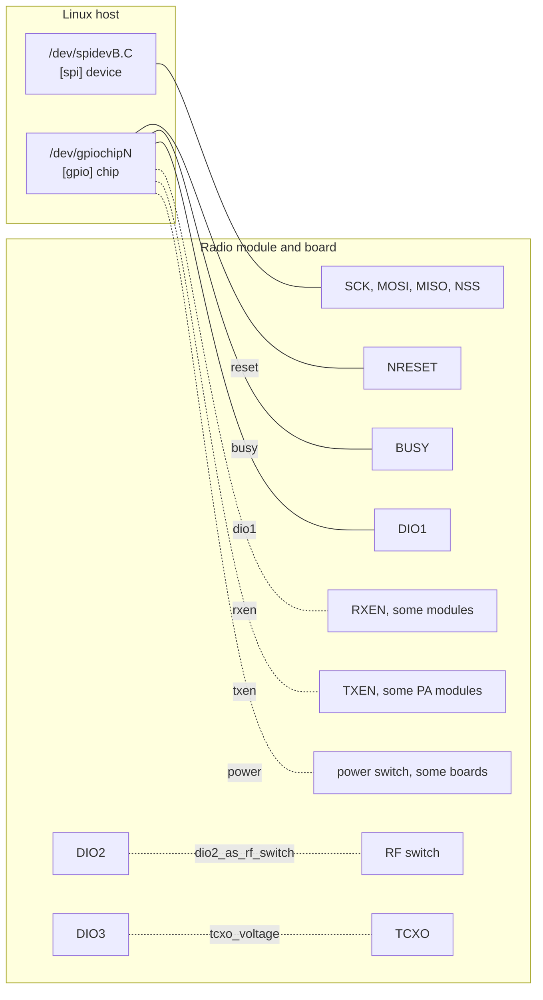

# Setting up the LoRa hardware

## What the daemon needs from the board

The `sx1262` driver talks to the modem through one spidev device and up to six GPIO lines on one
GPIO chip. Two of the modem's own pins, DIO2 and DIO3, are configured inside the chip and need no
host GPIO.



| Modem signal | Host side | Config key | How the daemon uses it |
| --- | --- | --- | --- |
| SCK, MOSI, MISO, NSS | spidev device; the kernel drives chip select | `[spi] device`, `speed_hz` | SPI mode 0, 8-bit words |
| NRESET | GPIO output | `[gpio] reset` | Held high; pulsed low for 10 ms by `begin()`; driven low on exit before `power_off_on_exit` switches the modem off |
| BUSY | GPIO input | `[gpio] busy` | Polled before every command, up to `busy_timeout_ms` |
| DIO1 | GPIO input with rising-edge events | `[gpio] dio1` | RX-done interrupt; wakes the event loop |
| RXEN (optional) | GPIO output | `[gpio] rxen` | Driven high when the radio starts and on every receive (firmware `rxAntEnable()`); without TXEN never low while the daemon runs, as in the firmware; with TXEN driven low before each transmission, before TXEN goes high; driven low on exit before `power_off_on_exit` switches the modem off |
| TXEN (optional) | GPIO output | `[gpio] txen` | Requested low; driven high before each transmission, after RXEN goes low, and low before receive, when the radio stops, and on exit before `power_off_on_exit` switches the modem off (firmware `beginPacket()`, `receive()` and `sleep_now()` with the KCT8103L's CTX) |
| Power enable (optional) | GPIO output | `[gpio] power` | Driven high before the other lines are requested; held while the daemon runs; driven low last on exit with `power_off_on_exit` |
| DIO2 | inside the module | `[radio.sx1262] dio2_as_rf_switch` | SX1262 drives the RF switch from DIO2 |
| DIO3 | inside the module | `[radio.sx1262] tcxo_voltage` | SX1262 powers the TCXO from DIO3 at this voltage |

GPIO lines are offsets on a GPIO chip: what `gpioinfo` lists, not physical header pin numbers and
not the global numbers of the old sysfs GPIO interface.

## uConsole CM5 with the HackerGadgets AIO V2

The AIO V2 has an SX1262 with a 1.8 V TCXO powered from DIO3 and an RF switch driven by DIO2. It
has no RXEN line. The board switches its peripherals on and off with GPIOs on the CM5's RP1:

| GPIO | Function |
| --- | --- |
| 16 | LoRa (SX1262) power |
| 7 | RTL-SDR power |
| 23 | internal USB power |
| 27 | GPS power |

1. **Enable SPI1.** The SX1262 sits on SPI1, chip select 0, which appears as `/dev/spidev1.0`. On
   the reference unit `/boot/firmware/config.txt` enables it with:

   ```text
   dtoverlay=spi1-1cs
   ```

   Reboot and check that `/dev/spidev1.0` exists. If your image runs `devterm-printer.service`, as
   Rex's Bookworm image does, stop and disable it: the DevTerm printer driver uses SPI1's pins too
   (HackerGadgets' [setup guide](https://hackergadgets.com/pages/hackergadgets-uconsole-rtl-sdr-lora-gps-rtc-usb-hub-all-in-one-extension-board-setup-guide)).

   ```sh
   sudo systemctl disable --now devterm-printer.service
   ```

2. **Find the GPIO chip.** The modem's control lines are on the RP1 GPIO controller, whose chip
   label is `pinctrl-rp1`. On the reference image that is `/dev/gpiochip15`; `gpiodetect` from the
   gpiod tools shows the number on yours. The lines are RESET = 25, BUSY = 24 and DIO1 = 26. If the
   chip number changes between kernels, set `chip = "pinctrl-rp1"`: the daemon also accepts a chip
   label.

3. **Mind the power rail.** The AIO setup on the reference unit drives all four rails low at boot
   from `config.txt` (`gpio=7,16,23,27=op,dl` in the `[cm5]` section), so the SX1262 has no power
   until something drives GPIO16 high. `power = 16` makes the daemon do that: it drives the line
   high, waits `power_on_delay_ms`, then resets the modem. `pinctrl get 16` shows the current state
   (`dh` means driven high). With the rail off, `begin()` fails.

4. **Install the config.** [`config.uconsole-aio-v2.toml`](../config.uconsole-aio-v2.toml) has the
   whole mapping:

   ```toml
   # Clockwork uConsole CM5 with HackerGadgets AIO V2 SX1262.

   [spi]
   device = "/dev/spidev1.0"
   speed_hz = 8_000_000

   [gpio]
   chip = "gpiochip15" # label: pinctrl-rp1
   power = 16
   power_on_delay_ms = 100
   power_off_on_exit = false
   reset = 25
   busy = 24
   dio1 = 26

   [radio]
   driver = "sx1262"
   avoid_interference = false
   # Cap the TX power hosts may set (0 to 22 dBm, default 22), e.g. for bench tests:
   # max_tx_power_dbm = 10

   [radio.sx1262]
   tcxo_voltage = "1.8V"
   dio2_as_rf_switch = true
   ocp = 0x28

   [pty]
   symlink = "/run/rnode/rnode0"
   # For an rnsd running as another user, add both accounts to dialout and uncomment these:
   # group = "dialout"
   # mode = "0660"

   [storage]
   radio_settings = "/var/lib/rnode/radio_settings.toml"

   [logging]
   log_level = "info"
   ```

   ```sh
   # from the Debian package:
   sudo install -m 0644 /usr/share/doc/rnode-nomu/examples/config.uconsole-aio-v2.toml /etc/rnode-nomu.toml
   # or from a checkout or a tarball:
   sudo install -m 0644 config.uconsole-aio-v2.toml /etc/rnode-nomu.toml
   ```

5. **Try it in the foreground.** The config puts the symlink in `/run/rnode` and the saved settings
   in `/var/lib/rnode`. systemd creates both for the service; for a manual run, create them for
   your user first:

   ```sh
   sudo install -d -o "$USER" /run/rnode /var/lib/rnode
   rnode-nomu --config /etc/rnode-nomu.toml
   ```

   Your user needs read/write access to `/dev/spidev1.0` and `/dev/gpiochip15` (see
   [device access](running.md#service-account-and-device-access)). The daemon logs the config file
   and the PTY, and waits with the radio off. It logs `radio online (host request): …` when a host
   turns the radio on, or `radio online (saved settings): …` at startup if a host saved its settings
   with `CMD_CONF_SAVE` earlier. Then continue with [Running with Reticulum](reticulum.md) and
   [Running as a systemd service](running.md#running-as-a-systemd-service).

The [hardware test tools](development.md#hardware-test-tools) can check the modem, the TCXO and the
RF output before you involve the daemon; [`tools/hwtest/README.md`](../tools/hwtest/README.md)
describes the procedure.

**Validation status.** On 2026-10-13 the daemon from `main` (commit `29018b7`) passed a validation
run on the reference uConsole AIO V2 at 914.875 MHz, 2 dBm, 125 kHz, SF7, CR 4/5:

- KISS detection, configuration, statistics and status pushes behaved as on an RNode;
- packets of 1, 254, 255 and 508 bytes went out as one or two LoRa frames, and 509 bytes were
  dropped;
- Reticulum's `RNodeInterface` came up and sent an announce;
- settings saved with `CMD_CONF_SAVE` brought the radio up after a restart;
- an RTL-SDR capture showed 24-symbol preambles, sync word `0x12` and frame durations within
  0.34 ms of the Semtech time on air.

A later run of `main` (commit `afe9882`) exchanged LXMF messages over the air with a hardware
RNode on a live Reticulum network (914.875 MHz, 125 kHz, SF8, CR 4/5, 2 dBm). The path request
was answered, and opportunistic and direct messages and a 2 KB resource transfer completed in
both directions, with two-frame split packets each way; one link packet was lost once and LXMF
resent it. Every packet showed up in the daemon's debug log.
[`tools/hwtest/README.md`](../tools/hwtest/README.md) has the results.

## uConsole with the HackerGadgets AIO V1

The AIO V1 carries the same radio as the V2: an SX1262 on SPI1, chip select 0, with RESET = 25,
BUSY = 24 and DIO1 = 26, an RF switch driven by DIO2 and a 1.8 V TCXO powered from DIO3. It has no
power rails, though: its LoRa module is powered whenever the uConsole is. HackerGadgets'
[setup guide for both boards](https://hackergadgets.com/pages/hackergadgets-uconsole-rtl-sdr-lora-gps-rtc-usb-hub-all-in-one-extension-board-setup-guide)
gives them the same radio configuration; only the V2 adds power GPIOs. Set up a V1 as the V2
above, with these differences:

- **No power rail.** Skip step 3, and install
  [`config.uconsole-aio-v1.toml`](../config.uconsole-aio-v1.toml) in step 4: it is the V2 file
  without `power`, `power_on_delay_ms` and `power_off_on_exit`. The quick start's
  `pinctrl get 16` check does not apply.
- **GPIO chip by label.** The file names the chip `pinctrl-rp1`, the label of a CM5's GPIO
  controller, so the daemon finds it whatever its number. On a CM4, set
  `chip = "pinctrl-bcm2711"`, and enable SPI1 with `dtparam=spi=on` as well as
  `dtoverlay=spi1-1cs`. Both apply to an AIO V2 on a CM4 too.
- **Beta-test boards.** The guide HackerGadgets wrote for the V1's beta-test boards never enables
  a TCXO. If the modem on such a board does not start, try without `tcxo_voltage`.

This configuration has not been tested on an AIO V1 yet.

## Mapping your own board

1. **Collect the wiring** from the module datasheet and your board's schematic:
   - which SPI controller and chip select the module uses;
   - which SoC GPIOs connect to NRESET, BUSY and DIO1, and to RXEN, TXEN or a power enable if the
     board has them;
   - whether DIO2 drives the RF switch;
   - whether DIO3 powers a TCXO, and at which voltage.

2. **Enable the SPI controller and a spidev node** with your board's device-tree overlay. On a
   Raspberry Pi, `dtparam=spi=on` gives `/dev/spidev0.0` and `/dev/spidev0.1`, and the `spi1-*cs`
   overlays give `/dev/spidev1.*`. The name is `spidev<bus>.<chip select>`, so the chip select is
   part of `[spi] device`. Check with `ls -l /dev/spidev*`.

3. **Translate GPIO names into chip and line.** `gpiodetect` lists the chips and their labels;
   `gpioinfo <chip>` lists the lines. On Raspberry Pi boards, BCM `GPIO25` is line 25 of the main
   GPIO chip (`pinctrl-rp1` on the Pi 5 and CM5). All lines must be on the one chip named by
   `[gpio] chip`.

4. **Write the config.** Start from [`config.example.toml`](../config.example.toml) and fill in:

   | Your board has | Set |
   | --- | --- |
   | Module on SPI bus B, chip select C | `[spi] device = "/dev/spidevB.C"` |
   | NRESET, BUSY, DIO1 on chip N, lines r, b, d | `[gpio] chip = "gpiochipN"`, `reset = r`, `busy = b`, `dio1 = d` |
   | Separate RX-enable pin | `[gpio] rxen = <line>` |
   | Separate TX-enable pin, for example of a PA module | `[gpio] txen = <line>` |
   | Switched power for the module | `[gpio] power = <line>`, and `power_on_delay_ms` if it needs longer to settle |
   | TCXO powered from DIO3 | `[radio.sx1262] tcxo_voltage = "1.8V"`, or the voltage in the module datasheet |
   | Plain crystal, no TCXO | leave `tcxo_voltage` unset |
   | RF switch driven by DIO2 | `dio2_as_rf_switch = true` (the default) |
   | RF switch driven some other way | `dio2_as_rf_switch = false` |
   | Power amplifier after the SX1262 | [`[radio.pa]`](configuration.md#radiopa) with its gain table |

   Modules with separate RX-enable and TX-enable pins, such as the Ebyte E22 series, are often wired
   with TXEN driven by DIO2 and RXEN by a host GPIO, as RNode_Firmware supports them. Where TXEN
   needs a host GPIO instead, set `txen` as well: the driver then never has RXEN and TXEN high
   together, and the KCT8103L's CTX input works the same way. With a PA, also set
   [`[radio.pa]`](configuration.md#radiopa).

   Use the TCXO voltage from the module's datasheet: a missing or wrong `tcxo_voltage` leaves the
   modem without a working reference clock, and too high a voltage can damage the TCXO.

5. **Check it** with `RUST_LOG=debug rnode-nomu --config config.toml --spilog spi.csv` and a host,
   and see [Troubleshooting](troubleshooting.md) if `begin()` fails.
