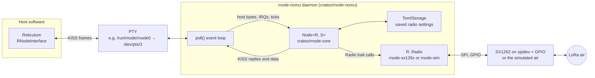
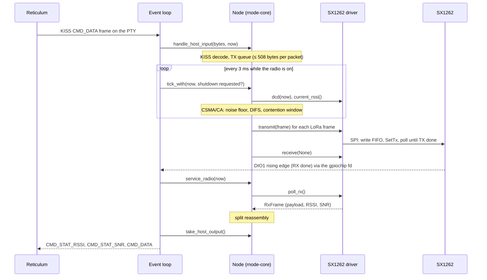

# How it works

The work is split into layers:

- **`rnode-core`** decides *what* an RNode does: the KISS host protocol, the TX queue, the RNode
  on-air framing (one header byte, packets over 254 bytes split into two LoRa frames), PHY timing,
  CSMA/CA and airtime accounting. It does no I/O: the platform passes the time in and calls it when
  the host sends bytes, when the radio signals, and periodically.
- **A radio driver** implements the `rnode_core::Radio` trait for one modem: SPI opcodes, registers,
  GPIO timing and chip quirks. See [Radio drivers](drivers.md).
- **The daemon** reads the config, opens spidev, the GPIO character device and the PTY, then runs
  the event loop: it waits on the PTY, the modem's IRQ line and the node's next wake-up time, and
  feeds whatever happened into the node.

A packet's round trip through the stack:

The event loop also calls `service_radio()` on every iteration, so a missed IRQ costs at most one
loop iteration of latency. While the radio is on, the loop wakes every 3 ms (firmware
`STATUS_INTERVAL_MS`) to sample carrier detect and RSSI for CSMA/CA, as the firmware does. While it
is off, the loop waits for at most 50 ms between checks.

## Differences from RNode_Firmware

rnode-nomu matches RNode_Firmware v1.86 wherever a host or another radio can observe the
behaviour, except for these deliberate differences:

**Host protocol** (most of these are listed in the module docs of `rnode_core::node`):

- KISS configuration commands retune the radio immediately while it is on.
- The RX and TX packet counters (`CMD_STAT_RX`, `CMD_STAT_TX`) count.
- An exactly 508-byte packet goes out as two LoRa frames. The firmware adds a third, header-only
  frame that carries no data and only leaves receivers with a stale half packet.
- Oversized raw frames in promiscuous mode are rejected with `ERROR_TXFAILED` or dropped, not
  truncated.
- The single-byte replies to `CMD_RANDOM` and `CMD_IMPLICIT` are KISS-escaped, so a value of
  `0xC0` cannot break the host's framing.
- Implicit-header receive is used only in promiscuous mode, so normal split RNode frames always keep
  explicit LoRa headers.
- `CMD_DIS_IA` changes interference avoidance for the running daemon only and sends no reply. The
  firmware writes the setting to EEPROM and reboots; here the persistent setting is
  `[radio] avoid_interference`.
- A modem can reject a frequency, bandwidth, spreading factor, coding rate or TX power, which the
  firmware's setters cannot. The node then keeps the value the modem last accepted and echoes
  that, as the firmware echoes the value it reads back, so the host sees that its setting did not
  take; see [Warnings](logging.md#warnings).
- A shutdown request cuts a burst of transmissions short. The firmware's `flush_queue()` sends
  every queued packet once a burst starts. rnode-nomu stops between packets, never between the two
  frames of a split packet, and drops the packets still queued; see
  [Stopping the daemon](running.md#stopping-the-daemon).
- `CMD_RESET` resets the node's state and reloads the saved settings without restarting the
  process, so the PTY stays open.
- There is no EEPROM. `CMD_ROM_READ` gets an image in the firmware's layout, built from the serial
  number, the saved settings and interference avoidance, with an empty signature, or from the info
  block `rnodeconf --rom` signed; see [Using rnodeconf](reticulum.md#using-rnodeconf). A locked
  image gets `ERROR_EEPROM_LOCKED` for `CMD_ROM_WRITE`, as on a provisioned RNode. An unprovisioned
  one, with [`[storage] eeprom`](configuration.md#storage) set and no file, takes writes to the info
  block only, where the firmware takes them up to address 199, and its lock byte only locks an info
  block the daemon would load. `CMD_UNLOCK_ROM`, with which the firmware erases its EEPROM, saved
  settings included, and reboots, gets `ERROR_EEPROM_LOCKED` and changes nothing.
- `CMD_FW_UPD`, `CMD_FW_HASH` and `CMD_DEV_SIG` are ignored with a `WARN` line each. As firmware
  without device hashes or Wi-Fi does, the node answers `CMD_DEV_HASH` and `CMD_HASHES` with
  nothing and `CMD_CFG_READ` with an empty config sector.
- Saved settings with a TX power from 128 to 254 are ignored with a warning, and the radio waits for
  a host. Earlier builds saved negative powers that way; see
  [Saved radio settings](configuration.md#saved-radio-settings). The firmware's EEPROM never holds
  such a value.
- The node identifies as a Linux platform: platform `0x60`, MCU `0x61` and board `0x60`, values
  that no firmware build uses, with firmware version 1.86.

**SX1262 driver** (crate docs of `rnode-sx126x`):

- Every `tcxo_voltage` uses the SX1262 datasheet's encoding. The firmware's board constants map
  2.4 V and 2.7 V to the 3.0 V setting, which it never selects.
- The TX-done wait scales with the frame's airtime instead of the firmware's fixed 20 s, which can
  abort valid long frames at SF12 and narrow bandwidths.
- A stuck BUSY line fails the command with `SX126x BUSY timeout` after `busy_timeout_ms`, where the
  firmware carries on.
- Carrier detect forgets a preamble detection once the preamble interrupt clears, so a completed
  short packet cannot make the next packet's preamble look stale.
- A received frame that fails its CRC is dropped as in the firmware, but the driver then reads its
  packet status (`GetPacketStatus`), a transaction the firmware does not make, for the
  [debug log](logging.md#packets-at-debug).
- With both [`[gpio] rxen` and `txen`](configuration.md#gpio), the driver drives RXEN low before
  TXEN goes high, and TXEN low before RXEN goes high, so the two are never high together. The
  firmware's SX1262 driver has no TXEN and never drives RXEN low; its SX1280 driver raises TXEN
  before it lowers RXEN. With `rxen` alone, RXEN is driven as in the firmware.
- With an LNA ([`[radio.pa] lna_gain_db`](configuration.md#radiopa)), the packet RSSI the host gets
  has the LNA's gain taken out, like the channel RSSI and the noise floor. The firmware's ESP32
  builds, the Heltec V4 with its LNA among them, read the packet RSSI with `packetRssi(uint8_t)`,
  which leaves the gain in, so a V4 reports received packets that much stronger.

Some firmware behaviour that surprises people is the same in rnode-nomu: `CMD_STAT_RSSI` before
the first received packet reports −36 dBm (the firmware's −292 dBm placeholder after the RSSI
offset wraps); `CMD_STAT_CHTM`, `CMD_STAT_PHYPRM` and `CMD_STAT_CSMA` are only pushed by the node,
never answered on request; and data frames over 508 bytes are dropped without an error.
